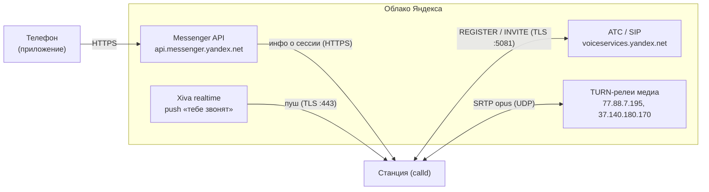

# Звонки Алисы и порт 5081

Снято со Станции Миди (`Yandex-Station-Midi-NK6K`, ПО `0.369.1.50...20261021`, root по ADB/SSH):
по `quasar.cfg` (секция `phone_calls.pjsip`), строкам и путям исходников в `strings maind`,
живому `calld.log` и сетевому захвату реального звонка (`call.pcap`, tcpdump на `wlan0`).
Помечено *(вывод)* то, что не подтверждено напрямую.

!!! abstract "Главное"
    **`tcp 5081` — транспорт SIP-телефонии Алисы (звонки),** модуль `pjsip`. Колонка выступает
    SIP-**клиентом** и сама дозванивается наружу, на АТС Яндекса (`voiceservices.yandex.net`,
    в захвате `93.158.134.246:5081`, TLS+TCP). Порт слушается только пока активны звонок или
    регистрация — вне звонка он закрыт. Телефон со станцией напрямую не общается: сигналинг
    и даже медиа идут через облако Яндекса.

## Для чего порт { #what }

Звонки живут внутри монолита `maind` (роль `--platformd`); подсистема называется `calld` и держит
внутренний gRPC/IPC на `127.0.0.1:9908`. SIP-движок — библиотека **pjsip/pjsua2**, обёрнутая
классами `YandexIO::AccountImpl` / `CallImpl`. Порт `5081` задаётся в `quasar.cfg`
(`sip_local_port = sip_remote_port = 5081`) и используется только как транспорт SIP-сигналинга
(REGISTER / INVITE / BYE) поверх TLS+TCP. Медиа (голос) по этому порту **не** передаётся — для него
поднимаются отдельные UDP-потоки (см. ниже).

## Три плоскости, не одна { #planes }

Звонок разнесён на **управляющую**, **сигнальную** и **медиа** плоскости — все идут в облако
Яндекса, телефон со станцией напрямую не общается.



- **Управляющая (HTTPS):** `api.messenger.yandex.net/api/` — создание и описание call-сессии,
  участники, выдача TURN-кредов *(вывод)*. Авторизация — OAuth-токен Паспорта владельца (`y0_...`).
- **Сигнальная триггерная (Xiva, TLS `:443`):** постоянные подписки `quasar-realtime` и
  `messenger-prod`. Именно сюда прилетает событие «входящий». В захвате — хосты
  `213.180.193.76/226/230`, `93.158.134.32`.
- **Сигнальная SIP (TLS `:5081`):** REGISTER / INVITE / BYE к АТС Яндекса. В захвате —
  `93.158.134.246:5081`. Плюс HTTP-регистрация `/ats_client/register_user`.
- **Медиа (UDP):** ICE + DTLS-SRTP + SRTP opus. В захвате — два потока RTP/RTCP на TURN-релеи
  `77.88.7.195` и `37.140.180.170`, а **не** на телефон.

## Как проходит входящий звонок (из приложения) { #incoming }

1. **Готовность.** После логина `authd` отдаёт токен Паспорта → `call_service` стартует и делает
   SIP REGISTER на АТС (TLS `:5081`, в логе `registration success, status=200`) и/или HTTP
   `/ats_client/register_user`. Пока регистрация жива, сокет `5081` открыт.
2. **Пуш «тебе звонят».** Бэкенд Мессенджера шлёт станции Xiva-push (канал `messenger-prod`) с
   идентификаторами вызова. Станция читает его из постоянного TLS-соединения с Xiva.
3. **Детали сессии.** `session_api_request` делает HTTPS-запрос на `api.messenger.yandex.net/api/`
   и получает описание сессии: участники, параметры медиа, предположительно креды ICE/TURN.
4. **SIP INVITE + SDP.** По каналу `:5081` приходит INVITE; pjmedia разбирает SDP (`m=audio`,
   `opus/48000`, крипто `a=crypto`/DTLS-fingerprint, ICE-кандидаты). Звенит рингтон; учитывается
   `do_not_disturb`.
5. **Ответ.** Голосом («Алиса, ответь») или из приложения → `pjsua_call_answer_with_sdp(...)`
   отдаёт SDP-answer.
6. **ICE.** Сбор кандидатов: *host* (локальные адреса), *srflx* (внешний адрес через STUN),
   *relay* (аллокация на TURN-сервере Яндекса). В реальном звонке выбран **TURN-релей** — прямой
   P2P с телефоном не состоялся, поэтому медиа пошло станция ↔ релей Яндекса.
7. **DTLS-SRTP + SRTP.** По выбранному ICE-каналу — DTLS-рукопожатие (mbedTLS), вывод ключей
   SRTP (либо SDES-ключи прямо из SDP). Дальше — SRTP opus (RTP + RTCP), звук сводится на
   динамик/микрофон через conference bridge.
8. **Завершение.** «Положи трубку» → `pjsua_call_hangup()` (SIP BYE). SRTP/DTLS останавливаются,
   медиа освобождается.

Исходящий звонок (станция кому-то) идёт тем же путём: голосовая команда → VINS → семантический
фрейм → CallKit заводит сессию через Messenger API → pjsua2 шлёт INVITE наружу (шаги 6–8 те же).

## Шифрование и приватность { #crypto }

- **Сигналинг** (SIP, Messenger, Xiva) — TLS 1.2 (BoringSSL), ECDHE → forward secrecy.
- **Медиа** — SRTP; ключи выводятся через DTLS-SRTP (mbedTLS) либо SDES. При DTLS-SRTP ключей нет
  в открытом SDP: чтобы расшифровать голос, нужен дамп ключей на самой станции (keylog/Frida),
  пассивный pcap не поможет.
- В захвате реального звонка **не было ни одного unicast-потока станция ↔ телефон**, хотя оба в
  одной Wi-Fi: даже локально медиа полностью релеится через серверы Яндекса.

## Параметры из `quasar.cfg` (секция `phone_calls.pjsip`) { #config }

```text
sip_local_port = 5081, sip_remote_port = 5081, sip_use_tcp = true, sip_use_tls = true
tls_config: ca_list_file = ${QUASAR}/ca-certificates.crt, verify_server = true
codecs_priority: opus/48000 = 150
account_media_config.srtp_mode = 2        # SRTP обязателен
ats_manager = true
```

`verify_server = true` означает, что TLS-рукопожатие на `5081` привередливо (нужны правильные SNI
и серверный сертификат) — «голый» коннект на порт просто так ничего не отдаёт.

## Адреса из реального захвата (AS13238 Яндекс) { #addresses }

| Роль | Хост:порт |
|---|---|
| Xiva / Messenger (сигналинг) | `213.180.193.76`, `.226`, `.230`, `93.158.134.32` : 443 |
| SIP / ATS | `93.158.134.246:5081` (`voiceservices.yandex.net`) |
| TURN-релеи медиа | `77.88.7.195`, `37.140.180.170` (RTP/RTCP, UDP) |

!!! note "Фолбэк-адреса мимо DNS"
    В `maind` зашита статическая таблица запасных IP для ключевых хостов телефонии
    (`voiceservices.yandex.net`, `uniproxy.alice.yandex.net`). Поэтому подмена одного DNS для
    изоляции звонков может не сработать — нужны правки hosts/маршрутов. См. также
    [DNS: unbound](network.md#dns-unbound).

## Варианты «звонковых» фич { #variants }

Один и тот же call-стек переиспользуется несколькими сценариями (в бинаре enum провайдеров
`MESSENGER` / `ATS` / `TELEPHONE`):

- **Звонки из приложения «Дом с Алисой»** — провайдер `MESSENGER` (разобрано выше).
- **«Алиса, найди мой телефон»** — провайдер `ATS/TELEPHONE`: телефонный бэкенд Яндекса сам
  звонит на номер, привязанный к Яндекс ID владельца. Только российские номера (+7 7xx из
  Казахстана не дозвонится).
- **«Звонки с колонки, как с телефона»** (МТС + Яндекс) — провайдер `ATS`: исходящие/входящие на
  обычные номера. Бета, только РФ, абоненты МТС.
- **Радионяня** — провайдер `MESSENGER`, но это трансляция звука из комнаты (в бинаре
  `CALL_CONNECTED_NANNY`), построенная поверх того же call-стека.
