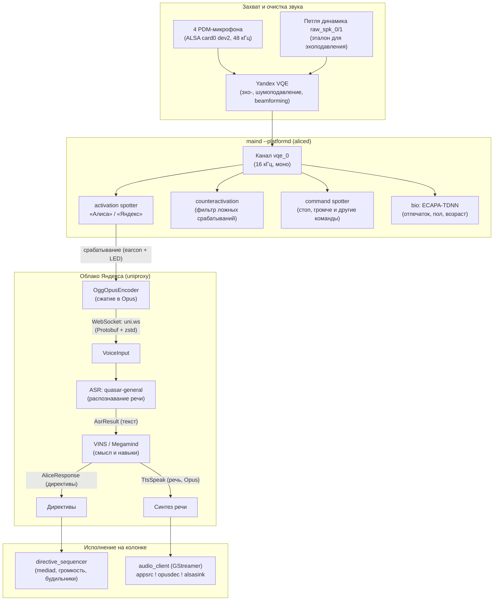

# Голосовой тракт Алисы

Как колонка слышит, распознаёт и отвечает. Снято с Amlogic-Станции (quasar 3.21): по
`quasar.cfg` (`audiod`, `aliced`, `audiosender`, `bio_capability`), моделям в `spotter_models/`
и `bio_lingware/`, путям исходников в `strings maind` и логам `maind.log`. Помечено *(вывод)*
то, что не подтверждено напрямую.

!!! abstract "Главное"
    На устройстве распознаётся **только ключевое слово и ~25 коротких команд**. Полное
    распознавание речи (ASR) и понимание (VINS/Megamind) — **в облаке** (`withLocalVins: false`).
    Без доступа к `uniproxy` колонка не превращает речь в текст.



## 1. Захват звука — `audiod`

Внутри `maind --platformd`. В исходном снятом профиле ALSA card 0, device 2 (`PDM-dummy`,
в конфиге `dmicarray`), `inRate` 48000, `micChannels` 4, `spkChannels` 2, `outRate` 16000.
Каналы (`audiosender.availableChannels`): `raw_mic_0..3`, `raw_spk_0..1` (что играет
динамик) и `vqe_0`. `brokenMicDetector` следит за RMS микрофонов.

Набор каналов зависит от модели и сборки. На Станции Лайт 1 / Micro v1.2 с прошивкой
`0.369.1.46.4778262442.20261013.297` при тех же 4 микрофонных и 2 опорных каналах в
`audiosender.availableChannels` есть ещё `vqe_bnr`, то есть всего восемь каналов;
`speechkitLogChannels` содержит `vqe_0` и `vqe_bnr`. Назначение `vqe_bnr` не установлено.
Подробности проверки — на [странице Лайт 1](../devices/station-lite.md#vqe).

## 2. Обработка — Yandex VQE

Тип VQE и preset зависят от модели. В исходном снятом профиле: `vqe.type: yandex`,
`preset: yandexmini`, `omniMode: true`. На проверенной Лайт 1 / Micro v1.2 —
`vqe.type: yandex`, `preset: yandexmicro`; `mainChannel` и `spotterChannelName` равны
`vqe_0`. Эхоподавление идёт по `raw_spk_*` (Алиса слышит вас поверх своей музыки),
формирование луча и шумоподавление определяются конкретным профилем VQE.

Основной обработанный выход — канал **`vqe_0`**: его слушают спотеры и его же отправляют
в облако. На Лайт 1 этот поток дополнительно проверен внешним realtime-ассистентом, в том
числе во время собственного воспроизведения колонки: речь поверх ответа продолжала поступать
и использовалась для barge-in. Количественное качество эхоподавления не измерялось.

Для Лайт 2 / Plum проверен [захват обработанного `vqe_0`](../recipes/microphone.md)
через экспортированный интерфейс VQE. Конфигурация Plum отличается от приведённых выше:
два микрофонных канала и один опорный, выход — моно 16 кГц.

## 3. Локальные нейросети

Движок `nnet`, признаки `cmn:lda`, модели в `spotter_models/` (обновляются с CDN Яндекса в
`/data/quasar/data/spotter_model`, сборочные — fallback):

Состав командных споттеров управляется аккаунтом: в `account_config` —
`enabledCommandSpotters.music.{playAndPause,volume,navigation,feedback,bluetooth}`,
`tv.{navigation,backToHome}`, `smartHome.{light,tv}` и `alwaysOnMicForShortcuts`; в приложении это
ползунки категории «Ассистент». Поэтому набор быстрых команд у разных колонок отличается.

| Модель | Задача |
|---|---|
| `activation/alisa`, `activation/yandex`, `activation/yasmina` | ключевые слова «Алиса», «Яндекс» и «Ясмина» (международная версия Yango); загружено одно, выбранное в приложении, работает всегда |
| `counteractivation` | подавление ложных срабатываний (например «Алиса» из рекламы по ТВ) |
| `command` | ~25 команд **без** ключевого слова: дальше, назад, громче, тише, стоп, хватит, пауза, играй, включи/выключи, свет, телевизор, блютуз, лайк/дизлайк… (`words.txt`) |
| `vad` | `<speech_started>` / `<speech_finished>` |
| `bio_lingware/*` | голосовой отпечаток (ECAPA-TDNN) + пол/возраст — «узнавание» пользователя (`MatchedUser`, `Biometry.Classification`) |

Подтверждено логом: `command_spotter_capability.cpp: Command phrase spotted: ^ дизлайк`.

На указанной Лайт 1 включена `bio_capability`; в `bio_lingware` есть модели
ECAPA-TDNN и локальные классификаторы. Пороги `guest` и `confidence`
в конфиге — 0,66 и 0,815. Получение результата распознавания сторонним
приложением не проверялось.

### Формат моделей { #nnet-format }

**Проверено на:** Станция 2, прошивка 0.369.1.46, октябрь 2026.

Модели исполняет библиотека `/system/vendor/quasar/libs/libyandex_evil.so` (пространство
имён `Spotter`), `maind` её только загружает. В каталоге каждой модели три файла:

- `acoustic_model.nnet` — сама сеть;
- `flags.txt` — признаки и пороги: `spotter-type chen14`, 40 mel-полос, окно 25 мс, шаг
  10 мс, порог `subthresholds`;
- `words.txt` — классы выхода: `filler` и само слово.

`acoustic_model.nnet` — бинарный [Kaldi](https://kaldi-asr.org/) nnet3 (файл начинается
с `\0B<Nnet3>`) со своими слоями Яндекса. Штатные утилиты Kaldi его поэтому не прочитают.

| Часть файла | Что внутри |
|---|---|
| Граф сети | текстом: `input-node`, `component-node`, `output-node` |
| Слои Kaldi | `FixedAffine`, `FixedBias` и `FixedScale` (нормализация CMVN), `RectifiedLinear`, `Softmax` |
| `GroupConvCorouComponent` | своя свёртка по времени на каждый канал: матрица «каналы × 12–32 кадра» и `ContextParam` |
| `Q16FixedAffineComponent`, `Q16GroupConvCorouComponent` | те же слои с весами int16: масштаб `<S>` и матрица с меткой `SIM` |
| `hardswish` | функция активации без параметров |
| `MultichannelAttention(…)` | дескриптор входа слоя, есть только в «Алисе» |

Сеть — стопка SVDF-блоков: проекция признаков, свёртка по времени, ReLU и слой TDNN.
У «Алисы» 38 слоёв и 1,8 МБ, на выходе 2 класса; у `command` — 22 и 6 классов. Смысл
`ContextParam`, `<S>` (вес — `int16 × S`) и `MultichannelAttention` выведен по размерам и
именам, код этих слоёв не разобран *(вывод)*.

Разобрать модель на компьютере помогает [`contrib/spotter_nnet.py`][spotter-nnet]. Скрипт
печатает граф и слои; пять моделей Станции 2 он разбирает до последнего байта:

```sh
python3 contrib/spotter_nnet.py acoustic_model.nnet
```

### Своё слово вызова в движке { #ckws }

В `libyandex_evil.so` есть режим произвольного слова вызова, заданного текстом:
`Spotter::CKWS` (custom keyword spotting). Его параметры:

| Параметр | Назначение *(вывод по имени)* |
|---|---|
| `custom_spotter_keyword`, `custom_spotter_keyword_max_length` | само слово |
| `custom_spotter_ctc_head_model_path` | модель распознавания звуков (CTC) |
| `custom_spotter_verifier_model_path` | модель проверки срабатывания |
| `custom_keyword_spotter_first_stage_threshold`, `custom_spotter_span_min`, `custom_spotter_span_max` | пороги и длительность слова |

В `quasar.cfg` ему соответствует секция `customActivationSpotterSettings`. Режим работает
на NPU-моделях `.tflite`, как `spotterRecognizer`: на это указывает ошибка
`Failed to cast NpuAmConfig to AudioEmbedderConfig` *(вывод)*.

На Станции 2 режим не включён. Моделей CTC и верификатора в прошивке нет, `spotter.json`
содержит `null`, каталог `/data/quasar/data/spotter_model` пуст. Откуда их берут колонки
с включённым режимом, неизвестно. Поэтому своё слово вызова на этой прошивке не задать:
можно подменить только файл `nnet`, а инструментов обучения моделей этого формата нет.

[spotter-nnet]: https://github.com/Marker284/yandex-station-extended/blob/main/contrib/spotter_nnet.py

## 4. Активация → поток в облако (SpeechKit)

- На срабатывание: звуковой сигнал earcon (`playStartVoiceInputEarcon`,
  `activation_feedback_player`) и анимация светодиодов.
- `RecognizerSession`/`Recorder` → `OggOpusEncoder` → `UniProxyImpl` по WebSocket на `uniProxyUrl`.
- Протокол: **protobuf Alice API** (`useProtoAliceApi: true`), сжатие **zstd** (`wsUseZstd: true`).
- Соединение держится постоянно (в логе `UniProxyProtocolState … PongTimeoutElapsed` при обрывах).

| Клиентские события | Серверные события |
|---|---|
| `VoiceInput`, `TextInput`, `AsrRecognize`, `LogSpotter`, `MatchedUser`, `TtsGenerate` | `InputStartAck`, `AsrResult`, `SpotterValidation`, `AliceResponse`, `TtsSpeak`, `TtsTimings` |

- `SpotterValidation` — сервер перепроверяет ключевое слово по присланному аудио
  *(вывод по названию)*.
- `vadEnabled: false` → конец фразы определяет **сервер**, а не локальный VAD.

На Лайт 1 с прошивкой `0.369.1.46.4778262442.20261013.297` в `maind` также
найдены `VoiceActivityDetectorCapability`, `SetVadActionDirective` и типы событий
`SpeechStartedRawEventType` / `SpeechFinishedRawEventType`.
Это подтверждает наличие внутренних механизмов VAD, **но не доказывает**,
что сторонний процесс может подписаться на эти события. Способ подключения не проверен.

### Проверенный uplink `VoiceInput` на Лайт 1 { #voiceinput-uplink }

**Проверено 2 ноября 2026** на Станции Лайт 1, прошивка
`0.369.1.46.4778262442.20261013.297`, прозрачным прокси между колонкой и штатным
`uniproxy`.

Бинарные кадры, привязанные к stock `VoiceInput`, после удаления транспортного `streamId`
составляют обычный **Ogg/Opus**. `OpusHead` сообщает исходную частоту 16 кГц, один канал;
в `OpusTags` обнаружен `ENCODER=SpeechKit Mobile SDK v4.16`. Декодер Opus использует
стандартную временную шкалу 48 кГц, поэтому `ffprobe` показывает `sample_rate=48000`, хотя
поле input sample rate в заголовке Opus равно 16000. Это не означает, что VQE внезапно
переключается на 48 кГц.

В том же захвате штатный облачный ASR успешно вернул финальный `AsrResult` для очень тихих
по цифровому уровню записей:

| Финальная фраза `AsrResult` | Длительность | RMS после декодирования | Peak |
|---|---:|---:|---:|
| `Опять проверка слышишь меня` | 2,36 с | −65,6 dBFS | −47,8 dBFS |
| `Скажи 7` | 4,48 с | −70,0 dBFS | −48,2 dBFS |
| `3 + 2` | 2,68 с | −72,2 dBFS | −52,6 dBFS |
| `Хорошо стоп` | 3,06 с | −76,5 dBFS | −53,9 dBFS |

Это **цифровые уровни декодированного uplink, а не акустические dB SPL**. Их нельзя
напрямую превращать в «дальность микрофона» или считать коэффициентом усиления VQE.
Тем не менее практический вывод важен: низкий RMS сам по себе не означает плохое
распознавание штатным SpeechKit. В отдельном внешнем тракте `vqe_0 → PCM → Gemini` сигнал
после дополнительного усиления был заметно громче, но распознавание дальней/тихой речи было
хуже. Поэтому попытка исправить внешний ASR только постоянным gain/AGC не воспроизводит
поведение штатного SpeechKit и может лишь добавить клиппинг на близкой речи.

### Потоковые `AsrResult` во время речи { #asr-partials }

На Лайт 1 подтверждено, что при `enable_partials` SpeechKit возвращает не только финальный
результат после конца фразы, но и промежуточные `AsrResult` прямо во время речи. Гипотезы
приходят накопительно: сервер повторно присылает уже распознанный префикс и дописывает к нему
новые слова, а не отправляет только дельту. Поэтому клиент, который хочет кормить partial-текст
другому LLM, должен сам вычислять стабильный префикс/дельту и учитывать, что ASR может
пересмотреть последние слова.

В одном контрольном запросе `VoiceInput` начался в `t=0`; первый partial `Расскажи` пришёл
примерно через 1,84 с, после чего текст обновлялся примерно каждые 0,3–0,5 с:

```text
Расскажи
Расскажи мне
Расскажи мне пожалуйста
Расскажи мне пожалуйста почему
...
Расскажи мне пожалуйста почему небо голубое и какая завтра будет погода
```

Полная фраза появилась примерно на `t=5,05 с`, а финальный результат — на `t=5,55 с`, то
есть полный текст был доступен примерно за 0,5 с до официальной финализации turn. Это один
измеренный пример, а не гарантированный SLA: задержка зависит от длины фразы, сети и серверного
ASR. Практически это позволяет заранее передавать стабильные partial-гипотезы своему LLM, но
запускать окончательный ответ только после финального `AsrResult`.

### Определение шёпота: локально или в облаке { #whisper }

**Проверено 6 ноября 2026:** Станция Лайт 1 (`yandexmicro`), штатная программа
`/system/vendor/quasar/maind`, quasar `3.21`. SHA-256 бинарника:
`2dad0ffc61ba73d15ea813b754d7a56866d0477c321dcad9138b8d06e14ddbf1`.
Проверены запущенная колонка по ADB и идентичная сохранённая копия `maind`.

В `maind` найдены две строки:

| Строка | Смещение в ELF-файле | Что известно |
|---|---|---|
| `is_whisper` | `0x2AF64F` | Имя признака шёпота; код обработки не восстановлен |
| `asr_whisper` | `0x2C41F9` | Имя ASR-метаданных; источник значения не доказан одной строкой |

В каталогах `spotter_models/`, `bio_lingware/` и `vqe_models/` на этой Лайт 1
отдельная модель с именем, указывающим на классификацию шёпота, не обнаружена.
Там есть модели ключевого слова, команд, VAD, биометрии и шумоподавления.
Отсутствие отдельного файла **не исключает** классификатор, встроенный в библиотеку
или общую нейросеть.

В [документированной схеме Megamind][whisper-events-proto] у `TEvent` есть
`AsrWhisper = 16` (protobuf `bool`, JSON-имя `asr_whisper`).
Это поле внутренних данных Megamind, **не доказательство**, что оно передаётся
в точности с таким же тегом в клиентском Alice API.

Для старого JSON-формата UniProxy совместимый
[сервер-эмулятор quasard][whisper-quasard] формирует **серверный** ответ
`ASR.Result` с флагом `payload.whisperInfo.isWhisper` (у эмулятора жёстко
задано `false`):

```json
{
  "directive": {
    "header": {"namespace": "ASR", "name": "Result"},
    "payload": {"whisperInfo": {"isWhisper": false}}
  }
}
```

В [другом клиентском примере][whisper-client] значение `whisperInfo.isWhisper`
читается именно из ответа UniProxy. Оба проекта подтверждают **форму обмена**
в совместимом JSON-протоколе, но не подтверждают, что текущий штатный protobuf
`AsrResult` на Лайт 1 всегда передаёт тот же признак.

**Вывод по совокупности признаков:** классификация шёпота, скорее всего,
выполняется в облачном тракте ASR, а `maind` получает её результат.
Полное распознавание речи на этой колонке уже установлено как облачное.
Однако непосредственный сетевой захват `whisper=true/false` на двух одинаковых
фразах, произнесённых шёпотом и обычным голосом, **не проводился**; поэтому
полностью исключить дополнительную локальную классификацию пока нельзя.

Для интеграции собственного LLM важно сначала проверить наличие флага в
реальном серверном `AsrResult`/директиве, а не определять шёпот только по RMS:
тихий обычный голос и шёпот — разные типы звучания. Отдельно нужно проверить,
как штатный синтез речи принимает команду отвечать шёпотом.

[whisper-events-proto]: https://github.com/v3rt3p/quasar-protos/blob/047f930157c934ca2d7811fd0cf68bb0c5f7d1c4/alice/megamind/protos/common/events.proto
[whisper-quasard]: https://github.com/amirilivice/quasard/blob/main/alice_server/protocol.py
[whisper-client]: https://github.com/Myp3a/Tasya-core/blob/master/ya_integration.py

### `waitClientApproval`: использовать SpeechKit только как ASR { #asr-approval }

На том же стенде проверен полезный для гибридных ассистентов режим protobuf AAPI. Если в
`VoiceInput` включить `WaitClientApproval`, колонка продолжает отправлять Ogg/Opus в
SpeechKit и получает финальный `AsrResult`, но прокси может отложить штатное продолжение
диалога до своего решения. После распознавания он может:

- отправить `ContinueRequest` и оставить запрос обычной Алисе;
- либо отменить штатное выполнение (`CancelRequest`, local execution) и передать текст из
  `AsrResult.Recognition[0].Normalized` своему LLM/автоматизации.

Таким образом возможна схема **«штатные VQE + SpeechKit как уши → свой LLM как мозг → свой
или штатный TTS»** без самостоятельного far-field STT. Это не офлайн-режим: аудио по-прежнему
уходит в облако Яндекса, а поведение серверного API может измениться. Локальные activation- и
command-spotter при этом остаются отдельным слоем на колонке.


## 5. Облако

ASR: `shortRecognizerModel: quasar-general`, промежуточные гипотезы (`enable_partials`).
`music_recognizer` — распознавание играющей музыки. Диалог и навыки — VINS/Megamind;
`experiments`/`supportedFeatures` сообщают серверу, что умеет устройство (так он и отличает
«болталку» от команд умного дома — маршрутизация на стороне облака).

## 6. Ответ

- `AliceResponse` → `directive_sequencer routeDirective … via <Capability>` (в логе: `set_timezone`/
  `set_location` через GeoSyncCapability, `notify` через NotificationCapability).
- Речь: `TtsSpeak` → `audio_client_tts_player.cpp` → GStreamer:
  `appsrc ! opusparse ! opusdec ! volume ! alsasink`. Музыка — в `maind --mediad`.
- Текстовые запросы (из приложения) идут как `Vins.TextInput` и **минуют ASR**.

В `maind` также обнаружены `IntonationSpottingCapability`,
`CancelRequest.ReasonUserStop`, `CancelRequest.ReasonInterruption` и обработка
прерывания TTS. Это полезные ориентиры для исследования штатного перебивания,
но подключение их к ответам стороннего ассистента пока не проверено.

### Потоковый TTS и частичные ответы { #tts-streaming }

В protobuf Alice API у `TtsSpeak` есть поля, которых нет в краткой таблице выше:
`LazyTtsStreaming`, `SoundChunkType` (`CHUNK_DEFAULT` / `CHUNK_WITH_META`) и
`SubStreamId`. Отдельный `StreamControl` содержит действие `LazyTTS` с полем
`ChunkSize`; клиент также может отправлять `TtsUpdateState` с длительностью уже
проигранного TTS, флагом `IsPlaying`, причиной отчёта (`Interruption` / `Finish`) и
`SubStreamId`.

Точная семантика `LazyTTS` по одной схеме protobuf **не установлена**. В старом
SpeechKit-протоколе есть отдельное действие `ACTION_NEXT_CHUNK`, но структуры
протоколов различаются, поэтому считать его прямым прежним названием `LazyTTS` без
захвата реального обмена нельзя.

Обычный `AliceResponse.TResponse` имеет флаг `IsStreaming`. Для последующих частей
ответа в AAPI существует `DeferredAliceResponse`: сообщение содержит
`ResponsePartialNum`, `IsLast`, `RequestId`, а его `BaseResponse` — `Text` и
`Directives`. Поэтому один логический ответ протокол может представить
последовательностью частичных сообщений.

Это само по себе **не означает**, что текст можно дописывать в уже открытый
`TtsGenerate`. В опубликованной схеме `TTtsGenerate` текст передаётся обычным полем
`Text`; прежнее поле с именем `RealtimeStreamer` зарезервировано, и его семантика из
текущей схемы не восстанавливается ([`TTtsGenerate`][aapi-tts-generate]).

На стороне прошивки наличие `TTS.Speak` с `lazy_tts_streaming` и следующего за ним
бинарного аудиопотока по `streamId` независимо подтверждено статическим разбором
`maind` на Station Mini 3 (`bergamot`, семейство прошивок 0.369)
([разбор][yastationd-tts-re]). Подробности и protobuf-схемы:
[TTS.Speak][aapi-tts-speak], [StreamControl][aapi-stream-control],
[TtsUpdateState][aapi-tts-state], [AliceResponse][aapi-alice-response] и
[DeferredAliceResponse][aapi-deferred-response].

!!! example "Практический пример: `quasar-bridge`"
    Это уже **реализация сообщества, а не доказанное штатное поведение облака**.
    В `quasar-bridge` структура `oggSpeech` объединяет независимо синтезированные
    Opus-сегменты в один Ogg-поток: сохраняет общую последовательность страниц и
    временную шкалу, а Ogg EOS / `StreamControl.Close` откладывает до последнего
    сегмента. Тест проекта отдельно проверяет, что финальный TTS не запускает второй
    проигрыватель, а его аудио продолжает исходный stream. См. [реализацию
    `oggSpeech`][quasar-bridge-ogg] и [тест deferred TTS][quasar-bridge-progress-test].

[aapi-tts-speak]: https://github.com/v3rt3p/quasar-protos/blob/master/alice/protos/api/alicekit/events/tts_speak/tts_speak.proto
[aapi-stream-control]: https://github.com/v3rt3p/quasar-protos/blob/master/alice/protos/api/alicekit/events/stream_control/stream_control.proto
[aapi-tts-state]: https://github.com/v3rt3p/quasar-protos/blob/master/alice/protos/api/alicekit/events/tts_update_state/tts_update_state.proto
[aapi-alice-response]: https://github.com/v3rt3p/quasar-protos/blob/master/alice/protos/api/alicekit/events/alice_response/alice_response.proto
[aapi-deferred-response]: https://github.com/v3rt3p/quasar-protos/blob/master/alice/protos/api/alicekit/streaming/deffered_response.proto
[aapi-tts-generate]: https://github.com/v3rt3p/quasar-protos/blob/master/alice/protos/api/alicekit/events/tts_generate/tts_generate.proto
[yastationd-tts-re]: https://github.com/celebeing/yastationd/blob/main/docs/research/tts-decompile.md
[quasar-bridge-ogg]: https://github.com/skrashevich/quasar-bridge/blob/main/internal/bridge/ogg.go
[quasar-bridge-progress-test]: https://github.com/skrashevich/quasar-bridge/blob/main/internal/bridge/progress_test.go

### Потоковые профили `audioclient` { #audioclient-streams }

На проверенной Лайт 1 / Micro v1.2 (`0.369.1.46.4778262442.20261013.297`) в `quasar.cfg`
у `audioclient.controller.playbackParams` есть три потоковых режима:

| Режим | Пайплайн / отличие |
|---|---|
| `OPUS_STREAM` | `appsrc ! opusparse ! opusdec ! ... ! alsasink` |
| `PCM_STREAM` | `appsrc` с `input_media_type` → `audioresample` → `alsasink` |
| `PCM_STREAM_WITH_BUFFER` | тот же PCM-путь, но `MULTIQUEUE` заменён на буферизующий `multiqueue` |

Общий `deviceName` для этих пайплайнов — ALSA `default`; на этой же сборке `mediad`
слушает локальный порт `9900`, `audioclient` — `9906`. Это подтверждённая конфигурация
конкретной прошивки, а не обещание стабильного публичного API между версиями.

В `maind` есть `AudioFocusDispatcher` — штатное согласование приоритетов
воспроизведения. Для своего плеера этот слой важно учитывать, чтобы речь,
музыка и системные звуки не конфликтовали. Стабильный внешний API не установлен.

В конфиге той же Лайт 1 включён `smart_volume.enabled: true`; присутствуют
пороги и правила восстановления громкости. Реальное поведение этих правил
отдельно не измерялось.

## Звук активации { #activation-sound }

Короткий сигнал на «Алису» прошивка проигрывает сама, на срабатывании: в логе через ~5 мс после
`onPhraseSpotted` идёт `routeDirective … local_audio_file_play via AudioFilePlayerCapability` с тем
же `vins`, что и у `listen.VOICE_INPUT`, — до любого ответа сервера.

Управляет им настройка «звук активации» в приложении: она приходит с синхронизацией аккаунта
в конфиг станции, в `account_config` это флаг `jingle` (о `"jingle": false` — ещё
[Mini 3 Pro, «Звук»](../devices/station-mini3-pro.md#audio)). При `"jingle": false` директивы
после срабатывания нет, и станция на слово молчит.

Флаг живёт в конфиге станции, а не в ответах uniproxy, поэтому со своим сервером на месте облака
звук работает так же. Проверено на Станции Лайт (quasar 0.369.1.46.4778262442.20261013.297)
с подменённым `uniProxyUrl` на эмулятор uniproxy ([quasard](../recipes/quasard.md)
с бэкендом своего ассистента). Какой файл при этом играет, не проверялось.

На этой же Лайт 1 в живом `quasar.cfg` обнаружена настройка отдельного
механизма быстрого звука пробуждения (`Seam Activation Feedback`):

```text
enableSeamActivationFeedback: true
useSeamActivationFeedbackAsJingle: true
useFilePlayerJingle: false
seamActivationFeedbackAsJingleDelayMs: 0
```

В данных устройства присутствуют девять файлов
`seam_activation_feedback_1.opus` … `seam_activation_feedback_9.opus`.
Это не отменяет наблюдение выше о `local_audio_file_play`:
какая ветка реально выдаёт слышимый звук и когда происходит переключение,
требует отдельного замера и трассировки.

## Отправка аудио помимо запросов

`audiosender` держит кольцевой буфер `historySeconds: 10` по настроенным каналам. В исходном
профиле их семь; на проверенной Лайт 1 — восемь, включая дополнительный `vqe_bnr`.
`cachingSoundLogSender` / `logsound/*` (`SoundLogStorage`, `UniProxyLogSender`,
`random_sound_logger`) отправляют «звуковые логи» срабатываний; случайная запись включена для
групп `allowedForRandomLoggingQuasmodromGroups: ["beta"]`.

## Что это значит для своего ASR/LLM

Это прямо отвечает на вопросы из [«Своя LLM вместо Алисы»](../recipes/llm.md):

- **Текст запроса без uniproxy не получить** — ASR облачный. Нужно либо перехватить поток на
  `uni.ws` (TLS + protobuf, как с quasar-бэкендом), либо забирать звук самостоятельно.
  Каналы `vqe_0`/`raw_mic_*` живут внутри `maind`; прямой параллельный захват штатного ALSA-
  устройства не является универсальным способом. Захват `vqe_0` через интерфейс VQE проверен
  на [Лайт 2](../recipes/microphone.md) и отдельно на [Лайт 1](../devices/station-lite.md#vqe);
  на Лайт 1 он продолжал работать и во время собственного воспроизведения колонки.
- Если интернет и отправка речи в Яндекс допустимы, есть третий гибридный вариант: оставить
  штатный SpeechKit только для STT, получить финальный `AsrResult` и уже после него выбрать
  свой LLM/автоматизацию через [`WaitClientApproval`](#asr-approval). Это сохраняет штатное
  far-field распознавание и не требует воспроизводить его одним gain/AGC поверх `vqe_0`.
- **Произнести свой текст** проще всего локально — через API glagol на порту 1961, как это
  делает интеграция YandexStation для Home Assistant — см. [Сеть → glagol](network.md#glagol).
  Для Plum также проверен [вызов `START_VOCALIZE` через SSH](../recipes/sounds.md#native-tts).
  Оба варианта используют облачный синтез; из облака ответ приходит как `AliceResponse.TtsSpeak`.
- **Подмена адреса**: пиннинга сертификатов нет — см. [Подводные камни](gotchas.md).
  Параметр `uniProxyUrl` можно увести на свой сервер, в том числе по `ws://` без TLS.
- **Рабочий пример** — [quasard](../recipes/quasard.md): свой uniproxy (JSON и protobuf
  `AAPI`), ASR, LLM и TTS вместо облака.

!!! warning "Колонка может отправлять фрагменты звука в облако"
    Колонка постоянно держит соединение с облаком, а для «beta»-групп может отправлять случайные
    звуковые фрагменты. Учитывайте это при изоляции колонки от внешнего интернета.
