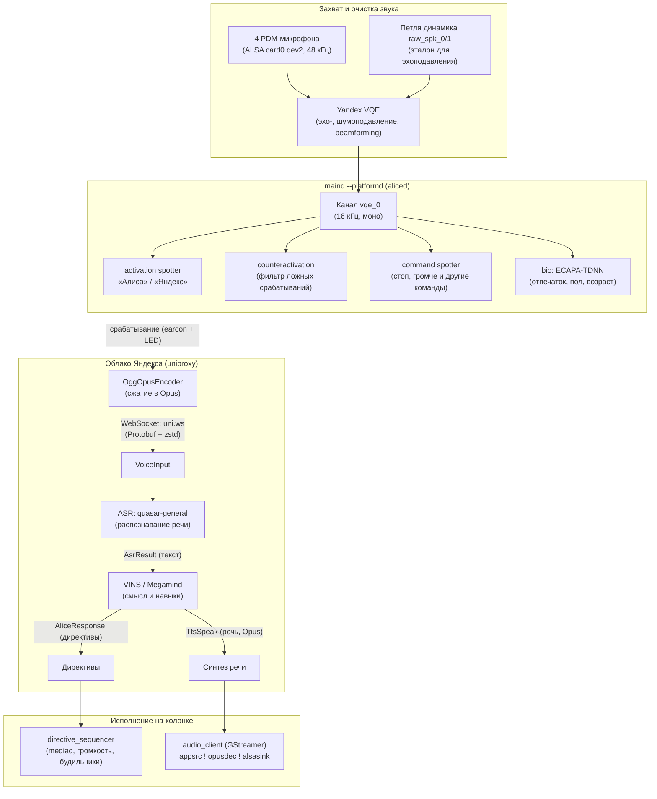

# Голосовой тракт Алисы

Как колонка слышит, распознаёт и отвечает. Снято с Amlogic-Станции (quasar 3.21): по
`quasar.cfg` (`audiod`, `aliced`, `audiosender`, `bio_capability`), моделям в `spotter_models/`
и `bio_lingware/`, путям исходников в `strings maind` и логам `maind.log`. Помечено *(вывод)*
то, что не подтверждено напрямую.

!!! abstract "Главное"
    На устройстве распознаётся **только ключевое слово и ~25 коротких команд**. Полное
    распознавание речи (ASR) и понимание (VINS/Megamind) — **в облаке** (`withLocalVins: false`).
    Без доступа к `uniproxy` колонка не превращает речь в текст.



## 1. Захват звука — `audiod`

Внутри `maind --platformd`. ALSA card 0, device 2 (`PDM-dummy`, в конфиге `dmicarray`),
`inRate` 48000, `micChannels` 4, `spkChannels` 2, `outRate` 16000. Каналы
(`audiosender.availableChannels`): `raw_mic_0..3`, `raw_spk_0..1` (что играет динамик) и `vqe_0`.
`brokenMicDetector` следит за RMS микрофонов.

## 2. Обработка — Yandex VQE

`vqe.type: yandex`, `preset: yandexmini`, `omniMode: true`. Эхоподавление по `raw_spk_*` (Алиса
слышит вас поверх своей музыки), формирование луча, шумоподавление *(вывод по набору каналов)*.
Выход — канал **`vqe_0`**: его слушают спотеры (`spotterChannelName`) и его же отправляют в
облако (`speechkitLogChannels`).

Для Лайт 2 / Plum проверен [захват обработанного `vqe_0`](../recipes/microphone.md)
через экспортированный интерфейс VQE. Конфигурация Plum отличается от приведённого выше
профиля `yandexmini`: два микрофонных канала и один опорный, выход — моно 16 кГц.

## 3. Локальные нейросети

Движок `nnet`, признаки `cmn:lda`, модели в `spotter_models/` (обновляются с CDN Яндекса в
`/data/quasar/data/spotter_model`, сборочные — fallback):

Состав командных споттеров управляется аккаунтом: в `account_config` — `enabledCommandSpotters.music.{playAndPause,volume,navigation,feedback,bluetooth}`, `tv.{navigation,backToHome}`, `smartHome.{light,tv}` и `alwaysOnMicForShortcuts`; в приложении это ползунки категории «Ассистент». Поэтому набор быстрых команд у разных колонок отличается.

| Модель | Задача |
|---|---|
| `activation/alisa`, `activation/yandex`, `activation/yasmina` | ключевые слова «Алиса», «Яндекс» и «Ясмина» (международная версия Yango); загружено одно, выбранное в приложении, работает всегда |
| `counteractivation` | подавление ложных срабатываний (например «Алиса» из рекламы по ТВ) |
| `command` | ~25 команд **без** ключевого слова: дальше, назад, громче, тише, стоп, хватит, пауза, играй, включи/выключи, свет, телевизор, блютуз, лайк/дизлайк… (`words.txt`) |
| `vad` | `<speech_started>` / `<speech_finished>` |
| `bio_lingware/*` | голосовой отпечаток (ECAPA-TDNN) + пол/возраст — «узнавание» пользователя (`MatchedUser`, `Biometry.Classification`) |

Подтверждено логом: `command_spotter_capability.cpp: Command phrase spotted: ^ дизлайк`.

### Формат моделей { #nnet-format }

**Проверено на:** Станция 2, прошивка 0.369.1.46, октябрь 2026.

Модели исполняет библиотека `/system/vendor/quasar/libs/libyandex_evil.so` (пространство
имён `Spotter`), `maind` её только загружает. В каталоге каждой модели три файла:

- `acoustic_model.nnet` — сама сеть;
- `flags.txt` — признаки и пороги: `spotter-type chen14`, 40 mel-полос, окно 25 мс, шаг
  10 мс, порог `subthresholds`;
- `words.txt` — классы выхода: `filler` и само слово.

`acoustic_model.nnet` — бинарный [Kaldi](https://kaldi-asr.org/) nnet3 (файл начинается
с `\0B<Nnet3>`) со своими слоями Яндекса. Штатные утилиты Kaldi его поэтому не прочитают.

| Часть файла | Что внутри |
|---|---|
| Граф сети | текстом: `input-node`, `component-node`, `output-node` |
| Слои Kaldi | `FixedAffine`, `FixedBias` и `FixedScale` (нормализация CMVN), `RectifiedLinear`, `Softmax` |
| `GroupConvCorouComponent` | своя свёртка по времени на каждый канал: матрица «каналы × 12–32 кадра» и `ContextParam` |
| `Q16FixedAffineComponent`, `Q16GroupConvCorouComponent` | те же слои с весами int16: масштаб `<S>` и матрица с меткой `SIM` |
| `hardswish` | функция активации без параметров |
| `MultichannelAttention(…)` | дескриптор входа слоя, есть только в «Алисе» |

Сеть — стопка SVDF-блоков: проекция признаков, свёртка по времени, ReLU и слой TDNN.
У «Алисы» 38 слоёв и 1,8 МБ, на выходе 2 класса; у `command` — 22 и 6 классов. Смысл
`ContextParam`, `<S>` (вес — `int16 × S`) и `MultichannelAttention` выведен по размерам и
именам, код этих слоёв не разобран *(вывод)*.

Разобрать модель на компьютере помогает [`contrib/spotter_nnet.py`][spotter-nnet]. Скрипт
печатает граф и слои; пять моделей Станции 2 он разбирает до последнего байта:

```sh
python3 contrib/spotter_nnet.py acoustic_model.nnet
```

### Своё слово вызова в движке { #ckws }

В `libyandex_evil.so` есть режим произвольного слова вызова, заданного текстом:
`Spotter::CKWS` (custom keyword spotting). Его параметры:

| Параметр | Назначение *(вывод по имени)* |
|---|---|
| `custom_spotter_keyword`, `custom_spotter_keyword_max_length` | само слово |
| `custom_spotter_ctc_head_model_path` | модель распознавания звуков (CTC) |
| `custom_spotter_verifier_model_path` | модель проверки срабатывания |
| `custom_keyword_spotter_first_stage_threshold`, `custom_spotter_span_min`, `custom_spotter_span_max` | пороги и длительность слова |

В `quasar.cfg` ему соответствует секция `customActivationSpotterSettings`. Режим работает
на NPU-моделях `.tflite`, как `spotterRecognizer`: на это указывает ошибка
`Failed to cast NpuAmConfig to AudioEmbedderConfig` *(вывод)*.

На Станции 2 режим не включён. Моделей CTC и верификатора в прошивке нет, `spotter.json`
содержит `null`, каталог `/data/quasar/data/spotter_model` пуст. Откуда их берут колонки
с включённым режимом, неизвестно. Поэтому своё слово вызова на этой прошивке не задать:
можно подменить только файл `nnet`, а инструментов обучения моделей этого формата нет.

[spotter-nnet]: https://github.com/Marker284/yandex-station-extended/blob/main/contrib/spotter_nnet.py

## 4. Активация → поток в облако (SpeechKit)

- На срабатывание: звуковой сигнал earcon (`playStartVoiceInputEarcon`,
  `activation_feedback_player`) и анимация светодиодов.
- `RecognizerSession`/`Recorder` → `OggOpusEncoder` → `UniProxyImpl` по WebSocket на `uniProxyUrl`.
- Протокол: **protobuf Alice API** (`useProtoAliceApi: true`), сжатие **zstd** (`wsUseZstd: true`).
- Соединение держится постоянно (в логе `UniProxyProtocolState … PongTimeoutElapsed` при обрывах).

| Клиентские события | Серверные события |
|---|---|
| `VoiceInput`, `TextInput`, `AsrRecognize`, `LogSpotter`, `MatchedUser`, `TtsGenerate` | `InputStartAck`, `AsrResult`, `SpotterValidation`, `AliceResponse`, `TtsSpeak`, `TtsTimings` |

- `SpotterValidation` — сервер перепроверяет ключевое слово по присланному аудио
  *(вывод по названию)*.
- `vadEnabled: false` → конец фразы определяет **сервер**, а не локальный VAD.

## 5. Облако

ASR: `shortRecognizerModel: quasar-general`, промежуточные гипотезы (`enable_partials`).
`music_recognizer` — распознавание играющей музыки. Диалог и навыки — VINS/Megamind;
`experiments`/`supportedFeatures` сообщают серверу, что умеет устройство (так он и отличает
«болталку» от команд умного дома — маршрутизация на стороне облака).

## 6. Ответ

- `AliceResponse` → `directive_sequencer routeDirective … via <Capability>` (в логе: `set_timezone`/
  `set_location` через GeoSyncCapability, `notify` через NotificationCapability).
- Речь: `TtsSpeak` → `audio_client_tts_player.cpp` → GStreamer:
  `appsrc ! opusparse ! opusdec ! volume ! alsasink`. Музыка — в `maind --mediad`.
- Текстовые запросы (из приложения) идут как `Vins.TextInput` и **минуют ASR**.

### Потоковый TTS и частичные ответы { #tts-streaming }

В protobuf Alice API у `TtsSpeak` есть поля, которых нет в краткой таблице выше:
`LazyTtsStreaming`, `SoundChunkType` (`CHUNK_DEFAULT` / `CHUNK_WITH_META`) и
`SubStreamId`. Отдельный `StreamControl` содержит действие `LazyTTS` с полем
`ChunkSize`; клиент также может отправлять `TtsUpdateState` с длительностью уже
проигранного TTS, флагом `IsPlaying`, причиной отчёта (`Interruption` / `Finish`) и
`SubStreamId`.

Точная семантика `LazyTTS` по одной схеме protobuf **не установлена**. В старом
SpeechKit-протоколе есть отдельное действие `ACTION_NEXT_CHUNK`, но структуры
протоколов различаются, поэтому считать его прямым прежним названием `LazyTTS` без
захвата реального обмена нельзя.

Обычный `AliceResponse.TResponse` имеет флаг `IsStreaming`. Для последующих частей
ответа в AAPI существует `DeferredAliceResponse`: сообщение содержит
`ResponsePartialNum`, `IsLast`, `RequestId`, а его `BaseResponse` — `Text` и
`Directives`. Поэтому один логический ответ протокол может представить
последовательностью частичных сообщений.

Это само по себе **не означает**, что текст можно дописывать в уже открытый
`TtsGenerate`. В опубликованной схеме `TTtsGenerate` текст передаётся обычным полем
`Text`; прежнее поле с именем `RealtimeStreamer` зарезервировано, и его семантика из
текущей схемы не восстанавливается ([`TTtsGenerate`][aapi-tts-generate]).

На стороне прошивки наличие `TTS.Speak` с `lazy_tts_streaming` и следующего за ним
бинарного аудиопотока по `streamId` независимо подтверждено статическим разбором
`maind` на Station Mini 3 (`bergamot`, семейство прошивок 0.369)
([разбор][yastationd-tts-re]). Подробности и protobuf-схемы:
[TTS.Speak][aapi-tts-speak], [StreamControl][aapi-stream-control],
[TtsUpdateState][aapi-tts-state], [AliceResponse][aapi-alice-response] и
[DeferredAliceResponse][aapi-deferred-response].

!!! example "Практический пример: `quasar-bridge`"
    Это уже **реализация сообщества, а не доказанное штатное поведение облака**.
    В `quasar-bridge` структура `oggSpeech` объединяет независимо синтезированные
    Opus-сегменты в один Ogg-поток: сохраняет общую последовательность страниц и
    временную шкалу, а Ogg EOS / `StreamControl.Close` откладывает до последнего
    сегмента. Тест проекта отдельно проверяет, что финальный TTS не запускает второй
    проигрыватель, а его аудио продолжает исходный stream. См. [реализацию
    `oggSpeech`][quasar-bridge-ogg] и [тест deferred TTS][quasar-bridge-progress-test].

[aapi-tts-speak]: https://github.com/v3rt3p/quasar-protos/blob/master/alice/protos/api/alicekit/events/tts_speak/tts_speak.proto
[aapi-stream-control]: https://github.com/v3rt3p/quasar-protos/blob/master/alice/protos/api/alicekit/events/stream_control/stream_control.proto
[aapi-tts-state]: https://github.com/v3rt3p/quasar-protos/blob/master/alice/protos/api/alicekit/events/tts_update_state/tts_update_state.proto
[aapi-alice-response]: https://github.com/v3rt3p/quasar-protos/blob/master/alice/protos/api/alicekit/events/alice_response/alice_response.proto
[aapi-deferred-response]: https://github.com/v3rt3p/quasar-protos/blob/master/alice/protos/api/alicekit/streaming/deffered_response.proto
[aapi-tts-generate]: https://github.com/v3rt3p/quasar-protos/blob/master/alice/protos/api/alicekit/events/tts_generate/tts_generate.proto
[yastationd-tts-re]: https://github.com/celebeing/yastationd/blob/main/docs/research/tts-decompile.md
[quasar-bridge-ogg]: https://github.com/skrashevich/quasar-bridge/blob/main/internal/bridge/ogg.go
[quasar-bridge-progress-test]: https://github.com/skrashevich/quasar-bridge/blob/main/internal/bridge/progress_test.go

## Звук активации { #activation-sound }

Короткий сигнал на «Алису» прошивка проигрывает сама, на срабатывании: в логе через ~5 мс после
`onPhraseSpotted` идёт `routeDirective … local_audio_file_play via AudioFilePlayerCapability` с тем
же `vins`, что и у `listen.VOICE_INPUT`, — до любого ответа сервера.

Управляет им настройка «звук активации» в приложении: она приходит с синхронизацией аккаунта
в конфиг станции, в `account_config` это флаг `jingle` (о `"jingle": false` — ещё
[Mini 3 Pro, «Звук»](../devices/station-mini3-pro.md#audio)). При `"jingle": false` директивы
после срабатывания нет, и станция на слово молчит.

Флаг живёт в конфиге станции, а не в ответах uniproxy, поэтому со своим сервером на месте облака
звук работает так же. Проверено на Станции Лайт (quasar 0.369.1.46.4778262442.20261013.297)
с подменённым `uniProxyUrl` на эмулятор uniproxy ([quasard](../recipes/llm.md#quasard)
с бэкендом своего ассистента). Какой файл при этом играет, не проверялось.

## Отправка аудио помимо запросов

`audiosender` держит кольцевой буфер `historySeconds: 10` по всем 7 каналам.
`cachingSoundLogSender` / `logsound/*` (`SoundLogStorage`, `UniProxyLogSender`,
`random_sound_logger`) отправляют «звуковые логи» срабатываний; случайная запись включена для
групп `allowedForRandomLoggingQuasmodromGroups: ["beta"]`.

## Что это значит для своего ASR/LLM

Это прямо отвечает на вопросы из [«Своя LLM вместо Алисы»](../recipes/llm.md):

- **Текст запроса без uniproxy не получить** — ASR облачный. Нужно либо перехватить поток на
  `uni.ws` (TLS + protobuf, как с quasar-бэкендом), либо забирать звук самостоятельно: каналы
  `vqe_0`/`raw_mic_*` живут внутри `maind`, ALSA-устройство `hw:0,2` занято `audiod`
  *(одновременный захват не проверялся)*.
- **Произнести свой текст** проще всего локально — через API glagol на порту 1961, как это
  делает интеграция YandexStation для Home Assistant — см. [Сеть → glagol](network.md#glagol).
  Для Plum также проверен [вызов `START_VOCALIZE` через SSH](../recipes/sounds.md#native-tts).
  Оба варианта используют облачный синтез; из облака ответ приходит как `AliceResponse.TtsSpeak`.
- **Подмена адреса**: пиннинга сертификатов нет — см. [Подводные камни](gotchas.md).
  Параметр `uniProxyUrl` можно увести на свой сервер, в том числе по `ws://` без TLS.
- **Рабочий пример** — [quasard](../recipes/llm.md#quasard): свой uniproxy (JSON и protobuf
  `AAPI`), ASR, LLM и TTS вместо облака.

!!! warning "Колонка может отправлять фрагменты звука в облако"
    Колонка постоянно держит соединение с облаком, а для «beta»-групп может отправлять случайные
    звуковые фрагменты. Учитывайте это при изоляции колонки от внешнего интернета.
