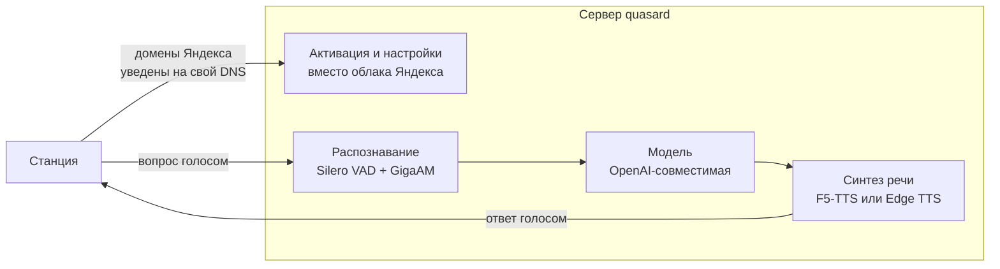

# Своя LLM вместо Алисы

Отвечать на общие вопросы своей моделью — ChatGPT, Claude, Ollama — вместо штатной Алисы.
Способов три, и они сильно разные: один оставляет голос Алисы и облако Яндекса, другой
заменяет облако целиком, третий подключает к колонке ChatGPT Voice.

## Какой способ выбрать { #compare }

| | [Quasar Bridge](#quasar-bridge) | [quasard](#quasard) | [ChatGPT Voice](#chatgpt-web) |
|---|---|---|---|
| Чей голос отвечает | Алисы | свой клон или синтез | ChatGPT |
| Умный дом Яндекса | работает | нет | работает вне чата |
| Музыка Яндекса | работает | своя реализация | ставится на паузу |
| Нужен интернет | да | только для облачной модели | да |
| Что нужно держать включённым | хост с прокси | компьютер с видеокартой | колонку; для моста — ещё Linux-ПК |
| Проверено на | Станция 2, Quasar 3.21 | прошивки ~1.56 и 3.x | Лайт 2 (Plum), 0.369.1.50 |

Quasar Bridge и quasard подменяют адрес сервера голосового соединения — ключи
`uniProxyUrl` и `uniProxyQuicUrl` в файле `/system/vendor/quasar/quasar.cfg`. Файл лежит
на системном разделе и правится после `mount -o remount,rw /`. ChatGPT Voice
адрес не меняет: он работает со звуком на самой колонке. Как устроена передача голоса от
микрофона до ответа, описано в [голосовом тракте Алисы](../internals/voice.md).

!!! danger "Quasar Bridge и quasard меняют системный конфиг"
    Перед подключением этих двух проектов снимите копию `quasar.cfg`, чтобы вернуть адреса:

    ```sh
    adb pull /system/vendor/quasar/quasar.cfg ./quasar.cfg.orig
    ```

    Все три проекта неофициальные, с Яндексом не связаны и годятся только для своих
    устройств.

## Quasar Bridge: своя LLM с голосом Алисы { #quasar-bridge }

[Quasar Bridge](https://github.com/skrashevich/quasar-bridge) — прокси на Go, который
распределяет запросы колонки между своей моделью, Home Assistant и Яндексом. Распознавание
речи и озвучивание ответов остаются облачными, поэтому отвечает голос Алисы.

### Как подключить { #bridge-setup }

1. Получите root и доступ по SSH.
2. Выберите, где запускать прокси: на отдельном хосте или на самой колонке через
   [YAM](packagemanagers.md). Готовые пакеты для Linux ARM64 и контрольные суммы лежат в
   [релизах проекта](https://github.com/skrashevich/quasar-bridge/releases).
3. Укажите в конфигурации OpenAI-совместимый адрес модели. Для управления домом
   подключите [HA MCP](https://github.com/homeassistant-ai/ha-mcp) и опишите правила
   маршрутизации под свои запросы.
4. Направьте `uniProxyUrl` и `uniProxyQuicUrl` колонки на свой сервер по
   [инструкции проекта](https://github.com/skrashevich/quasar-bridge#readme). Установка
   пакета сама по себе адрес не меняет.

### Как распределяются запросы { #bridge-routing }

| Запрос | Кто отвечает |
|---|---|
| Управление устройствами и вопросы об их состоянии | Home Assistant, формулирует своя модель |
| Сложные вопросы, «спроси нейросеть», чтение страниц и истории | своя модель |
| Музыка, погода, таймеры и остальные обычные команды | Яндекс |

Правила описываются в JSON и перечитываются без пересборки сервера. Если облачная Алиса
отказалась отвечать, запрос можно передать своей модели. Для подряд идущих локальных
вопросов сохраняется контекст диалога; модели доступны чтение страниц по адресу, поиск по
журналу запросов и текущее время. Журнал по умолчанию выключен.

### Ограничения { #bridge-limits }

- Привязка колонки к аккаунту Яндекса сохраняется: распознавание и синтез речи идут через
  облако даже тогда, когда отвечает своя модель.
- Прокси на колонке не означает модель на колонке: её API должен быть доступен по сети.
- Пакет собран для ARM64 и проверен на Станции 2. Остальные модели не проверялись.
- Медленный ответ модели прикрывается настраиваемым беззвучным ожиданием, но общий лимит
  обработки запроса остаётся.

## quasard: свой сервер вместо облака { #quasard }

[quasard](https://github.com/amirilivice/quasard) от [@amirilivice](https://github.com/amirilivice)
заменяет облако Алисы целиком. Колонка считает, что говорит с Яндексом, но активация,
разговор и музыка идут через ваш сервер, наружу станция больше не ходит.

### Как это работает { #quasard-how }



- **Активация без облака.** Сервер сам отвечает на запросы входа, регистрации,
  синхронизации, списка устройств и метрик. Обновления прошивки заблокированы, чтобы
  колонка не перешла на версию, которая всё сломает.
- **Оба формата голосового соединения.** На прошивках около 1.56 это JSON, на 3.x —
  двоичный protobuf. Формат определяется по первому кадру; схемы для 3.x восстановлены из
  прошивки и лежат в репозитории.
- **Распознавание** — GigaAM v3, модель сразу расставляет пунктуацию, конец фразы ловит
  Silero VAD. Занимает около 1 ГБ видеопамяти.
- **Ответы** — любой OpenAI-совместимый API: Groq, Ollama, vLLM, LM Studio. История
  диалога сохраняется, характер задаётся в файле `system_prompt.txt` рядом с конфигом и
  перечитывается на лету.
- **Ответ озвучивается по фразам.** Текст модели режется по знакам препинания, первая
  готовая фраза уходит на колонку, пока модель дописывает остальное, поэтому станция
  начинает говорить почти без паузы.
- **Голос** — клон по образцу на 10–15 секунд (F5-TTS, русские веса ESpeech, около 3,4 ГБ
  видеопамяти). Запасной вариант без видеокарты — Edge TTS.
- **Музыка** из Яндекс Музыки: «Моя волна», поиск по исполнителю, треку и альбому,
  «дальше», «назад», лайк, пауза, «что сейчас играет».
- **Быстрые команды** без модели: громкость, «стоп», bluetooth, сброс диалога.

Облачного умного дома и сценариев Яндекса при этом нет, и голос отвечает не Алисин.
Зато всё работает без аккаунта и без интернета — кроме самой модели и музыки, если они
облачные. Гибрид «своя модель для разговоров, облако для остального» на этой основе
собрать можно: сервер уже разбирает оба формата соединения и видит распознанный текст, не
хватает только проксирования остальных запросов в Яндекс.

### Что понадобится { #quasard-req }

- Windows или Linux с видеокартой NVIDIA. Проверялось на RTX 5080 с 16 ГБ.
- Python 3.12, [uv](https://github.com/astral-sh/uv) и ffmpeg.
- Роутер, на котором домены Яндекса уводятся на этот компьютер, принудительный DNS и
  сертификат, которому доверяет колонка. Настройка с примерами для OpenWrt описана в
  [документации проекта](https://github.com/amirilivice/quasard/blob/main/docs/TRAFFIC_CAPTURE.md).
- Ключ к облачной модели — по умолчанию бесплатный Groq — или своя локальная модель.

### Как запустить { #quasard-setup }

Склонируйте репозиторий и поднимите сервер:

=== "Windows"

    ```bat
    uv venv -p 3.12 .venv
    uv pip install -p .venv torch torchaudio --index-url https://download.pytorch.org/whl/cu128
    uv pip install -p .venv -r requirements.txt
    copy config.example.toml config.toml
    .venv\Scripts\python -m alice_server
    ```

=== "Linux"

    ```sh
    uv venv -p 3.12 .venv
    uv pip install -p .venv torch torchaudio --index-url https://download.pytorch.org/whl/cu128
    uv pip install -p .venv -r requirements.txt
    cp config.example.toml config.toml
    .venv/bin/python -m alice_server
    ```

Сервер слушает порты 80 и 443 — на них роутер и уводит домены Яндекса. Остальное есть в
[README проекта](https://github.com/amirilivice/quasard#readme), там же лежит `start.ps1`
для Windows.

Проверить сервер без колонки помогают имитаторы из каталога `tools`: `activation_sim.py`
повторяет активацию, `station_sim.py --text "Привет"` — разговор, `fake_llm.py` отвечает
вместо модели, если ключа ещё нет.

### Ограничения { #quasard-limits }

- Прямые ссылки Яндекс Музыки отдаются через переадресацию, и сервер проходит её за
  колонку: плеер старой прошивки переадресацию не понимает.
- Скорость и качество голоса упираются в видеокарту: на слабой первая фраза приходит
  через одну-две секунды.
- У бесплатных тарифов облачных моделей есть суточный лимит запросов.

## ChatGPT Voice: нативный режим и мост { #chatgpt-web }

[Alisa Voice][alisa-voice] подключает микрофоны и динамик Станции Лайт 2 к ChatGPT Voice.
В [версии 0.2.0][alisa-release] доступны два режима с общим установщиком:

| Режим | Где работает клиент | Что нужно держать включённым |
|---|---|---|
| Нативный | на колонке; WebRTC и обработка звука работают без ПК | только колонку |
| Мост | сайт ChatGPT в фоновом Chromium на Linux-ПК | колонку и ПК |

Распознавание речи и ответы ChatGPT в обоих случаях остаются облачными. Используется
аккаунт ChatGPT, API-ключ не нужен.

**Проверено на:** Станция Лайт 2 YNDX-00028 (Plum), прошивка
`0.369.1.50.4794654278.20261021.133`, CachyOS x86_64, 28 октября 2026.
Настоящие аккаунты Free и Plus проверены в обоих режимах; Go и Windows не проверены.
[Результаты проверки проекта][alisa-validation].

### Что понадобится { #chatgpt-req }

- Станция Лайт 2 с уже работающими [root и SSH](../start/ssh.md), доступная из сети ПК.
- Linux x86_64, Python 3.10+ и рабочий стол для первого входа в Chromium.
  В нативном режиме компьютер нужен для установки и настройки.
- Для моста — работающий PipeWire с PulseAudio-интерфейсом или PulseAudio.
- Аккаунт ChatGPT с доступным голосовым режимом и доступ колонки к сервисам Алисы.
- На колонке должен работать штатный Quasar. Также нужны socat и проигрыватель aplay из ALSA.

Мастер проверяет модель, SHA-256 maind и библиотеки VQE, свободное место и компоненты.
Готовые ARM-модули входят в релиз: Clang и LLD для установки не нужны. Недостающие пакеты
на ПК предлагается установить через pacman, apt-get или dnf. Из этих семейств полный
живой прогон выполнен только на CachyOS.

### Как подключить { #chatgpt-setup }

1. Запустите установщик в терминале Linux:

    ```sh
    curl -fsSL https://raw.githubusercontent.com/rison1337/Alisa-ChatGPT-voice-assistant/main/bootstrap-linux.sh | sh
    ```

2. Выберите нативный режим или мост.
3. Укажите IP, порт и пароль SSH колонки. После проверки мастер создаёт отдельный ключ;
   параметры подключения запоминаются, пароль не сохраняется. Псевдоним alice не нужен.
4. Выберите автозапуск, голосовые фразы и подсветку. В нативном режиме можно добавить
   VLESS для GPT по отдельной ссылке или подписке с выбором сервера.
5. Подтвердите установку после просмотра размера компонентов и свободного места.
6. Войдите в ChatGPT в открывшемся окне Chromium. Вход обнаруживается и сохраняется
   автоматически; закрывать окно вручную для подтверждения не нужно.
7. Запустите предложенный короткий тест голосового ответа.

Проверка сети показывает внешний IP и страну выхода: в нативном режиме — колонки,
в мосте — ПК. Для российского IP предлагается VPN. Эта проверка не подтверждает
доступность ChatGPT Voice; для этого служит отдельный голосовой тест после входа.
В нативном режиме после установки и входа ПК можно выключить.

### Команды и настройки { #chatgpt-usage }

| Команда по умолчанию | Что происходит |
|---|---|
| «Алиса, открой чат» | продолжить разговор с GPT |
| «Алиса, создай новый чат» | начать новый разговор |
| «Алиса, открой предыдущий чат» | вернуться к предыдущему разговору |
| «Алиса, закрой чат» | вернуть обычную Алису |

Управление после установки открывается командой:

```sh
~/.local/bin/alisa
```

В меню доступны смена аккаунта, фразы после «Алиса», подсветка с живым демо, автозапуск,
обновление и удаление. Голос нативного клиента выбирается в CLI, голос моста — на сайте
ChatGPT. Смена фраз и цвета применяется без перезапуска текущего разговора.

Оба режима можно держать установленными. Перед запуском другого остановите текущий:
они используют одни микрофоны и динамик. Настройки и входы раздельные; включение
автозапуска одного режима отключает автозапуск другого.

VLESS нативного клиента направляет через туннель только трафик GPT, включая WebRTC.
При потере туннеля прямое подключение блокируется, разговор завершается, управление
возвращается Алисе. Маршруты самой Алисы и SSH не заменяются.

### Ограничения { #chatgpt-limits }

- Это отдельный режим ChatGPT. Команды переключения распознаёт облако Яндекса;
  для входа и выхода голосом нужен доступ к нему.
- Пока идёт разговор с ChatGPT, ответы Алисы подавляются, штатная музыка ставится на паузу.
- Доступность и лимиты задаёт ChatGPT. Распознанные ошибки входа, соединения и лимита
  закрывают разговор и освобождают управление Алисе. Изменения сайта или протокола могут
  потребовать обновления клиента.
- В нативном режиме сессия хранится на колонке, в мосте — в отдельном профиле Chromium
  на ПК. Эти данные не входят в установочный пакет.
- Проверены одна колонка и одна сборка прошивки. При несовпадении проверяемых хешей
  установщик останавливается; другие сборки требуют проверки совместимости модулей.

В обоих режимах используются [обработанный микрофон VQE](microphone.md) и
[настраиваемая подсветка Plum](led.md#plum-led-rainbow).

### Как вернуть Алису { #chatgpt-rollback }

Отключите автозапуск выбранного режима и остановите его:

=== "Нативный"

    ```sh
    ~/.local/bin/alisa native autostart off
    ~/.local/bin/alisa native stop
    ```

=== "Мост"

    ```sh
    ~/.local/bin/alisa bridge autostart off
    ~/.local/bin/alisa bridge stop
    ```

Для удаления программных файлов выберите «Установка и обслуживание → Удалить программу».
Перед удалением показывается состав и создаётся резервная копия. Вход, чаты, root и SSH
сохраняются; выход из аккаунта выполняется отдельно в меню «Аккаунт ChatGPT».
Для удаления только VLESS и его файлов используйте меню «VPN / VLESS».

[alisa-voice]: https://github.com/rison1337/Alisa-ChatGPT-voice-assistant
[alisa-release]: https://github.com/rison1337/Alisa-ChatGPT-voice-assistant/releases/tag/v0.2.0
[alisa-validation]: https://github.com/rison1337/Alisa-ChatGPT-voice-assistant/blob/v0.2.0/docs/validation.md

## v3rt3p: самостоятельный стек { #v3rt3p }

Ещё один путь полностью заменить облако — [v3rt3p](https://v3rt3p.github.io/ru/index.html),
набор сервисов для своего голосового интерфейса. В отличие от домашних приложений «в один
клик», его разворачивают и настраивают вручную: выбор языковой модели, обработка звука и
отдельные компоненты протокола под своим контролем. Нужны навыки работы с Docker, DNS,
логами и ключами доступа. В вики проект не проверялся — описание и установка в его
[документации](https://v3rt3p.github.io/ru/index.html).

## Что пока не исследовано { #open }

- Как отличить обычный разговор от команды умного дома внутри голосового соединения.
  Разбор формата есть в [голосовом тракте](../internals/voice.md) и в коде quasard.
- Совместимость гибридного прокси с другими моделями и прошивками: проверен только
  Quasar Bridge на Станции 2.

Свой текст голосом Алисы — задача уже решённая: локально это делает API glagol, см.
[сеть и порты](../internals/network.md#glagol), а на Лайт 2 проверен
[вызов через SSH](sounds.md#native-tts).

## Откат { #rollback }

Общее для Quasar Bridge и quasard — вернуть исходный `quasar.cfg` из копии, снятой
[перед первой правкой](#compare), и перезагрузить колонку:

```sh
adb push ./quasar.cfg.orig /system/vendor/quasar/quasar.cfg
adb shell sync; adb reboot
```

Корневая файловая система для записи перемонтируется так же, как при правке:
`mount -o remount,rw /`.

- **Quasar Bridge** — остановить прокси и удалить его пакет, если ставили на колонку
  через YAM.
- **quasard** — выключить подмену DNS на роутере, чтобы домены Яндекса снова шли в облако.
- **ChatGPT Voice** — остановить выбранный режим или удалить его через CLI, как описано
  в [возврате к Алисе](#chatgpt-rollback).
