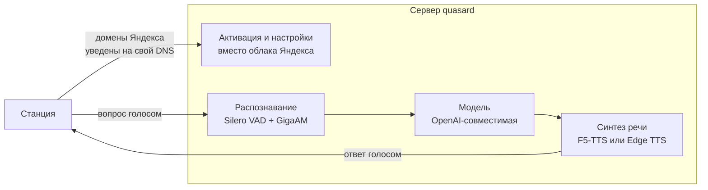

# Своя LLM вместо Алисы

Отвечать на общие вопросы своей моделью — ChatGPT, Claude, Ollama — вместо штатной Алисы.
Способов три, и они сильно разные: один оставляет голос Алисы и облако Яндекса, другой
заменяет облако целиком, третий подключает к колонке голосовой режим сайта ChatGPT.

## Какой способ выбрать { #compare }

| | [Quasar Bridge](#quasar-bridge) | [quasard](#quasard) | [Голосовой режим ChatGPT](#chatgpt-web) |
|---|---|---|---|
| Чей голос отвечает | Алисы | свой клон или синтез | ChatGPT |
| Умный дом Яндекса | работает | нет | работает вне чата |
| Музыка Яндекса | работает | своя реализация | ставится на паузу |
| Нужен интернет | да | только для облачной модели | да |
| Что нужно держать включённым | хост с прокси | компьютер с видеокартой | компьютер с Linux |
| Проверено на | Станция 2, Quasar 3.21 | прошивки ~1.56 и 3.x | Лайт 2 (Plum), 0.369.1.50 |

Quasar Bridge и quasard подменяют адрес сервера голосового соединения — ключи
`uniProxyUrl` и `uniProxyQuicUrl` в файле `/system/vendor/quasar/quasar.cfg`. Файл лежит
на системном разделе и правится после `mount -o remount,rw /`. Голосовой режим ChatGPT
адрес не меняет: он работает со звуком на самой колонке. Как устроена передача голоса от
микрофона до ответа, описано в [голосовом тракте Алисы](../internals/voice.md).

!!! danger "Это замена системных настроек колонки"
    Перед первой правкой снимите копию `quasar.cfg` — без неё вернуть адреса будет нечем:

    ```sh
    adb pull /system/vendor/quasar/quasar.cfg ./quasar.cfg.orig
    ```

    Все три проекта неофициальные, с Яндексом не связаны и годятся только для своих
    устройств.

## Quasar Bridge: своя LLM с голосом Алисы { #quasar-bridge }

[Quasar Bridge](https://github.com/skrashevich/quasar-bridge) — прокси на Go, который
распределяет запросы колонки между своей моделью, Home Assistant и Яндексом. Распознавание
речи и озвучивание ответов остаются облачными, поэтому отвечает голос Алисы.

### Как подключить { #bridge-setup }

1. Получите root и доступ по SSH.
2. Выберите, где запускать прокси: на отдельном хосте или на самой колонке через
   [YAM](yam.md). Готовые пакеты для Linux ARM64 и контрольные суммы лежат в
   [релизах проекта](https://github.com/skrashevich/quasar-bridge/releases).
3. Укажите в конфигурации OpenAI-совместимый адрес модели. Для управления домом
   подключите [HA MCP](https://github.com/homeassistant-ai/ha-mcp) и опишите правила
   маршрутизации под свои запросы.
4. Направьте `uniProxyUrl` и `uniProxyQuicUrl` колонки на свой сервер по
   [инструкции проекта](https://github.com/skrashevich/quasar-bridge#readme). Установка
   пакета сама по себе адрес не меняет.

### Как распределяются запросы { #bridge-routing }

| Запрос | Кто отвечает |
|---|---|
| Управление устройствами и вопросы об их состоянии | Home Assistant, формулирует своя модель |
| Сложные вопросы, «спроси нейросеть», чтение страниц и истории | своя модель |
| Музыка, погода, таймеры и остальные обычные команды | Яндекс |

Правила описываются в JSON и перечитываются без пересборки сервера. Если облачная Алиса
отказалась отвечать, запрос можно передать своей модели. Для подряд идущих локальных
вопросов сохраняется контекст диалога; модели доступны чтение страниц по адресу, поиск по
журналу запросов и текущее время. Журнал по умолчанию выключен.

### Ограничения { #bridge-limits }

- Привязка колонки к аккаунту Яндекса сохраняется: распознавание и синтез речи идут через
  облако даже тогда, когда отвечает своя модель.
- Прокси на колонке не означает модель на колонке: её API должен быть доступен по сети.
- Пакет собран для ARM64 и проверен на Станции 2. Остальные модели не проверялись.
- Медленный ответ модели прикрывается настраиваемым беззвучным ожиданием, но общий лимит
  обработки запроса остаётся.

## quasard: свой сервер вместо облака { #quasard }

[quasard](https://github.com/amirilivice/quasard) от [@amirilivice](https://github.com/amirilivice)
заменяет облако Алисы целиком. Колонка считает, что говорит с Яндексом, но активация,
разговор и музыка идут через ваш сервер, наружу станция больше не ходит.

### Как это работает { #quasard-how }



- **Активация без облака.** Сервер сам отвечает на запросы входа, регистрации,
  синхронизации, списка устройств и метрик. Обновления прошивки заблокированы, чтобы
  колонка не перешла на версию, которая всё сломает.
- **Оба формата голосового соединения.** На прошивках около 1.56 это JSON, на 3.x —
  двоичный protobuf. Формат определяется по первому кадру; схемы для 3.x восстановлены из
  прошивки и лежат в репозитории.
- **Распознавание** — GigaAM v3, модель сразу расставляет пунктуацию, конец фразы ловит
  Silero VAD. Занимает около 1 ГБ видеопамяти.
- **Ответы** — любой OpenAI-совместимый API: Groq, Ollama, vLLM, LM Studio. История
  диалога сохраняется, характер задаётся в файле `system_prompt.txt` рядом с конфигом и
  перечитывается на лету.
- **Ответ озвучивается по фразам.** Текст модели режется по знакам препинания, первая
  готовая фраза уходит на колонку, пока модель дописывает остальное, поэтому станция
  начинает говорить почти без паузы.
- **Голос** — клон по образцу на 10–15 секунд (F5-TTS, русские веса ESpeech, около 3,4 ГБ
  видеопамяти). Запасной вариант без видеокарты — Edge TTS.
- **Музыка** из Яндекс Музыки: «Моя волна», поиск по исполнителю, треку и альбому,
  «дальше», «назад», лайк, пауза, «что сейчас играет».
- **Быстрые команды** без модели: громкость, «стоп», bluetooth, сброс диалога.

Облачного умного дома и сценариев Яндекса при этом нет, и голос отвечает не Алисин.
Зато всё работает без аккаунта и без интернета — кроме самой модели и музыки, если они
облачные. Гибрид «своя модель для разговоров, облако для остального» на этой основе
собрать можно: сервер уже разбирает оба формата соединения и видит распознанный текст, не
хватает только проксирования остальных запросов в Яндекс.

### Что понадобится { #quasard-req }

- Windows или Linux с видеокартой NVIDIA. Проверялось на RTX 5080 с 16 ГБ.
- Python 3.12, [uv](https://github.com/astral-sh/uv) и ffmpeg.
- Роутер, на котором домены Яндекса уводятся на этот компьютер, принудительный DNS и
  сертификат, которому доверяет колонка. Настройка с примерами для OpenWrt описана в
  [документации проекта](https://github.com/amirilivice/quasard/blob/main/docs/TRAFFIC_CAPTURE.md).
- Ключ к облачной модели — по умолчанию бесплатный Groq — или своя локальная модель.

### Как запустить { #quasard-setup }

Склонируйте репозиторий и поднимите сервер:

=== "Windows"

    ```bat
    uv venv -p 3.12 .venv
    uv pip install -p .venv torch torchaudio --index-url https://download.pytorch.org/whl/cu128
    uv pip install -p .venv -r requirements.txt
    copy config.example.toml config.toml
    .venv\Scripts\python -m alice_server
    ```

=== "Linux"

    ```sh
    uv venv -p 3.12 .venv
    uv pip install -p .venv torch torchaudio --index-url https://download.pytorch.org/whl/cu128
    uv pip install -p .venv -r requirements.txt
    cp config.example.toml config.toml
    .venv/bin/python -m alice_server
    ```

Сервер слушает порты 80 и 443 — на них роутер и уводит домены Яндекса. Остальное есть в
[README проекта](https://github.com/amirilivice/quasard#readme), там же лежит `start.ps1`
для Windows.

Проверить сервер без колонки помогают имитаторы из каталога `tools`: `activation_sim.py`
повторяет активацию, `station_sim.py --text "Привет"` — разговор, `fake_llm.py` отвечает
вместо модели, если ключа ещё нет.

### Ограничения { #quasard-limits }

- Прямые ссылки Яндекс Музыки отдаются через переадресацию, и сервер проходит её за
  колонку: плеер старой прошивки переадресацию не понимает.
- Скорость и качество голоса упираются в видеокарту: на слабой первая фраза приходит
  через одну-две секунды.
- У бесплатных тарифов облачных моделей есть суточный лимит запросов.

## Голосовой режим сайта ChatGPT { #chatgpt-web }

[Alisa-ChatGPT-voice-assistant](https://github.com/rison1337/Alisa-ChatGPT-voice-assistant) —
мост между микрофонами и динамиком колонки и официальным сайтом ChatGPT. Сайт работает в
Chromium на виртуальном экране Xvfb, без окна на рабочем столе, и отвечает голосом ChatGPT.

### Что понадобится { #chatgpt-req }

- Колонка Лайт 2 с готовым root и входом по ключу. Проверена YNDX-00028 (Plum), прошивка
  `0.369.1.50.4794654278.20261021.133`.
- Компьютер с Linux, который работает всё время разговора. Проверялось на CachyOS с
  PipeWire-Pulse.
- Python 3.11 или новее, Chromium, Xvfb, xauth, OpenSSH, ALSA utilities, Clang и LLD.
  На колонке — штатный Quasar и `socat`.
- Аккаунт ChatGPT с доступным голосовым режимом.

### Как подключить { #chatgpt-setup }

1. Соберите модули для ARM32 по [README проекта](https://github.com/rison1337/Alisa-ChatGPT-voice-assistant).
2. Настройте псевдоним `alice` для входа по SSH и проверьте ключ хоста.
3. Запустите мост на компьютере:

    ```sh
    python3 bridge.py start
    ```

4. Один раз войдите на `chatgpt.com` в отдельном профиле Chromium и закройте окно входа.
5. Переключайте режим голосом:

    | Команда | Что происходит |
    |---|---|
    | «Алиса, открой чат» | голосовой режим предыдущего разговора |
    | «Алиса, создай новый чат» | новый разговор |
    | «Алиса, закрой чат» | выход и возврат к обычной Алисе |

Закрыть разговор из терминала: `python3 voice.py close`.

### Ограничения { #chatgpt-limits }

- Это отдельный режим, а не распределение каждого запроса между Яндексом и моделью. Адрес
  голосового сервера колонки при этом не меняется.
- Команды переключения распознаёт облако Яндекса. Без интернета выйти из разговора
  голосом не получится.
- Пока идёт разговор с ChatGPT, ответы Алисы подавляются, а штатная музыка стоит на паузе.
  Команду закрытия произносят в паузе: во время своего звука мост не реагирует на
  обращения к Алисе.
- Вход и лимиты задаёт сам сайт ChatGPT. Сессия хранится в профиле браузера на
  компьютере, а изменения интерфейса сайта могут потребовать обновления моста.
- Проверены [обработанный микрофон VQE](microphone.md) и
  [радужная подсветка Plum](led.md#plum-led). Другие модели не проверялись.

## v3rt3p: самостоятельный стек { #v3rt3p }

Ещё один путь полностью заменить облако — [v3rt3p](https://v3rt3p.github.io/ru/index.html),
набор сервисов для своего голосового интерфейса. В отличие от домашних приложений «в один
клик», его разворачивают и настраивают вручную: выбор языковой модели, обработка звука и
отдельные компоненты протокола под своим контролем. Нужны навыки работы с Docker, DNS,
логами и ключами доступа. В вики проект не проверялся — описание и установка в его
[документации](https://v3rt3p.github.io/ru/index.html).

## Что пока не исследовано { #open }

- Как отличить обычный разговор от команды умного дома внутри голосового соединения.
  Разбор формата есть в [голосовом тракте](../internals/voice.md) и в коде quasard.
- Совместимость гибридного прокси с другими моделями и прошивками: проверен только
  Quasar Bridge на Станции 2.

Свой текст голосом Алисы — задача уже решённая: локально это делает API glagol, см.
[сеть и порты](../internals/network.md#glagol), а на Лайт 2 проверен
[вызов через SSH](sounds.md#native-tts).

## Откат { #rollback }

Общее для Quasar Bridge и quasard — вернуть исходный `quasar.cfg` из копии, снятой
[перед первой правкой](#compare), и перезагрузить колонку:

```sh
adb push ./quasar.cfg.orig /system/vendor/quasar/quasar.cfg
adb shell sync; adb reboot
```

Корневая файловая система для записи перемонтируется так же, как при правке:
`mount -o remount,rw /`.

- **Quasar Bridge** — остановить прокси и удалить его пакет, если ставили на колонку
  через YAM.
- **quasard** — выключить подмену DNS на роутере, чтобы домены Яндекса снова шли в облако.
- **Голосовой режим ChatGPT** — `python3 voice.py close` на компьютере; на колонке
  остаются только вспомогательные процессы моста, их убирает его собственный деинсталлятор.
