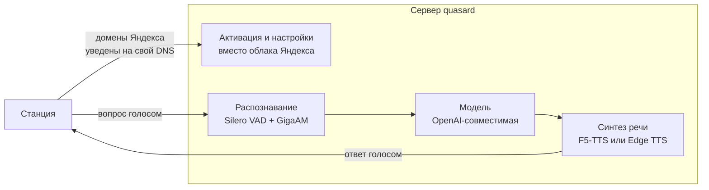

# quasard: свой сервер вместо облака { #quasard }

[quasard](https://github.com/amirilivice/quasard) от [@amirilivice](https://github.com/amirilivice)
заменяет облако Алисы целиком. Колонка считает, что говорит с Яндексом, но активация,
разговор и музыка идут через ваш сервер, наружу станция больше не ходит.

## Основная информация

=== "Характеристики"

     - **🛠️ Тип:** Полноценный бэкенд
     - **🚀 Статус:** ❔
     - **📱 Совместимость:** ❔
     - **🔒 Автономность:** Локальный с облачными функциями

=== "Возможности"

    - **🗣️ Голосовой ассистент:** ✅ Любая OpenAPI совместимая LLM
    - **🧮 Активация ближайшей колонки:** ❔
    - **🎵 Музыка:** ✅ Я.Музыка
    - **🔊 Мультирум:** ❔
    - **🧮 Активация ближайшей:** ❔
    - **🎧 Bluetooth: ✅
    - **🔊 Мультирум:** ❔
    - **🏠 Умный дом:** ❌
    - **⏰ Таймеры и будильники:** ❔
    - **🔔 Напоминания:** ❔
    - **📅 Календарь:** ❔
    - **🌤️ Погода:** ❔
    - **📢 Уведомления:** ❌
    - **📞 Звонки:** ❌

    ###### ✅ — работает, в т.ч. аналогично штатной Алисе 
    ###### 🟡 — реализовано частично или с ограничениями
    ###### ❌ — не реализовано
    ###### ❔ — не проверено

=== "Системные требования"

    - **⚙️ CPU:** 6 ядер
    - **🧮 RAM:** 16 ГБ
    - **💽 Диск:** 30 ГБ
    - **🎮 GPU:** Требуется
    - **💾 VRAM:** 8 ГБ

## Как это работает { #quasard-how }



- **Активация без облака.** Сервер сам отвечает на запросы входа, регистрации,
  синхронизации, списка устройств и метрик. Обновления прошивки заблокированы, чтобы
  колонка не перешла на версию, которая всё сломает.
- **Оба формата голосового соединения.** На прошивках около 1.56 это JSON, на 3.x —
  двоичный protobuf. Формат определяется по первому кадру; схемы для 3.x восстановлены из
  прошивки и лежат в репозитории.
- **Распознавание** — GigaAM v3, модель сразу расставляет пунктуацию, конец фразы ловит
  Silero VAD. Занимает около 1 ГБ видеопамяти.
- **Ответы** — любой OpenAI-совместимый API: Groq, Ollama, vLLM, LM Studio. История
  диалога сохраняется, характер задаётся в файле `system_prompt.txt` рядом с конфигом и
  перечитывается на лету.
- **Ответ озвучивается по фразам.** Текст модели режется по знакам препинания, первая
  готовая фраза уходит на колонку, пока модель дописывает остальное, поэтому станция
  начинает говорить почти без паузы.
- **Голос** — клон по образцу на 10–15 секунд (F5-TTS, русские веса ESpeech, около 3,4 ГБ
  видеопамяти). Запасной вариант без видеокарты — Edge TTS.
- **Музыка** из Яндекс Музыки: «Моя волна», поиск по исполнителю, треку и альбому,
  «дальше», «назад», лайк, пауза, «что сейчас играет».
- **Быстрые команды** без модели: громкость, «стоп», bluetooth, сброс диалога.

Облачного умного дома и сценариев Яндекса при этом нет, и голос отвечает не Алисин.
Зато всё работает без аккаунта и без интернета — кроме самой модели и музыки, если они
облачные. Гибрид «своя модель для разговоров, облако для остального» на этой основе
собрать можно: сервер уже разбирает оба формата соединения и видит распознанный текст, не
хватает только проксирования остальных запросов в Яндекс.

### Что понадобится { #quasard-req }

- Windows или Linux с видеокартой NVIDIA. Проверялось на RTX 5080 с 16 ГБ.
- Python 3.12, [uv](https://github.com/astral-sh/uv) и ffmpeg.
- Роутер, на котором домены Яндекса уводятся на этот компьютер, принудительный DNS и
  сертификат, которому доверяет колонка. Настройка с примерами для OpenWrt описана в
  [документации проекта](https://github.com/amirilivice/quasard/blob/main/docs/TRAFFIC_CAPTURE.md).
- Ключ к облачной модели — по умолчанию бесплатный Groq — или своя локальная модель.

### Как запустить { #quasard-setup }

Склонируйте репозиторий и поднимите сервер:

=== "Windows"

    ```bat
    uv venv -p 3.12 .venv
    uv pip install -p .venv torch torchaudio --index-url https://download.pytorch.org/whl/cu128
    uv pip install -p .venv -r requirements.txt
    copy config.example.toml config.toml
    .venv\Scripts\python -m alice_server
    ```

=== "Linux"

    ```sh
    uv venv -p 3.12 .venv
    uv pip install -p .venv torch torchaudio --index-url https://download.pytorch.org/whl/cu128
    uv pip install -p .venv -r requirements.txt
    cp config.example.toml config.toml
    .venv/bin/python -m alice_server
    ```

Сервер слушает порты 80 и 443 — на них роутер и уводит домены Яндекса. Остальное есть в
[README проекта](https://github.com/amirilivice/quasard#readme), там же лежит `start.ps1`
для Windows.

Проверить сервер без колонки помогают имитаторы из каталога `tools`: `activation_sim.py`
повторяет активацию, `station_sim.py --text "Привет"` — разговор, `fake_llm.py` отвечает
вместо модели, если ключа ещё нет.

### Ограничения { #quasard-limits }

- Прямые ссылки Яндекс Музыки отдаются через переадресацию, и сервер проходит её за
  колонку: плеер старой прошивки переадресацию не понимает.
- Скорость и качество голоса упираются в видеокарту: на слабой первая фраза приходит
  через одну-две секунды.
- У бесплатных тарифов облачных моделей есть суточный лимит запросов.

## Ссылки

📖 [Документация](https://github.com/amirilivice/quasard#quasard)
📚 [Проект](https://github.com/amirilivice/quasard)