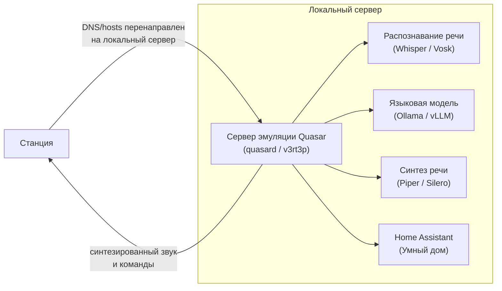

# Свой бэкенд (Self-hosted) вместо облака

Полная замена облачных серверов Яндекса на собственный сервер. Колонка перенаправляет
голосовые запросы, авторизацию и медиапотоки на локальный стек, наружу в интернет больше не обращается.

## Как это устроено { #how }

Колонка обращается к серверам Яндекса по доменным именам (например, `quasar.yandex.net`).
С помощью подмены DNS на роутере или локального `hosts` на рутованной колонке весь этот трафик
заворачивается на ваш локальный сервер.



## Доступные решения { #solutions }

### 1. quasard { #quasard }

[quasard](https://github.com/amirilivice/quasard) — легковесный сервер на Go, реализующий
протокол взаимодействия с прошивкой Quasar.

- **Назначение:** эмуляция сервисов авторизации, конфигурации и голосового WebSocket-туннеля.
- **Особенности:** минимальное потребление ресурсов, простая настройка через конфигурационный файл.
- **Совместимость:** проверено на прошивках ~1.56 и 3.x (Станция 2, Мини 1/2).

### 2. Стек v3rt3p { #v3rt3p }

[v3rt3p](https://github.com/v3rt3p) — модульный self-hosted стек в Docker-контейнерах,
включающий в себя полный конвейер голосового ассистента:

- **ASR (распознавание):** Faster-Whisper.
- **LLM (диалог):** интеграция с Ollama / LocalAI.
- **TTS (синтез):** Piper с поддержкой голосов на русском языке.
- **Умный дом:** прямая связка с Home Assistant.

## Что понадобится { #requirements }

- Колонка с полученным [root](../start/index.md#root-by-model) и [SSH](../start/ssh.md).
- Домашний сервер или ПК под управлением Linux (Ubuntu/Debian) с Docker и Docker Compose.
  Для комфортной работы распознавания и LLM рекомендуется от 16 ГБ ОЗУ и видеокарта NVIDIA
  (от 6–8 ГБ VRAM) либо процессор с поддержкой AVX2.
- Роутер с возможностью перенаправления DNS-запросов (dnsmasq, AdGuard Home, Pi-hole)
  либо правка `/etc/hosts` на самой колонке.

## Установка и настройка { #install }

### Шаг 1. Разверните бэкенд на сервере

1. Склонируйте репозиторий выбранного бэкенда:
   ```sh
   git clone https://github.com/amirilivice/quasard.git
   cd quasard
   ```
2. Настройте конфигурационный файл `config.yaml`, указав адреса локальных сервисов ASR, LLM и TTS.
3. Запустите контейнеры:
   ```sh
   docker compose up -d
   ```

### Шаг 2. Перенаправьте трафик колонки

Направьте домены Яндекса на IP-адрес вашего локального сервера:

```text
quasar.yandex.net
yandex.net
quasar.s3.yandex.net
```

Если подмена настраивается на роутере в `dnsmasq`:
```text
address=/quasar.yandex.net/<IP_СЕРВЕРА>
```

Если колонка переводится точечно, пропишите адреса в `/etc/hosts` на самой колонке:
```sh
mount -o remount,rw /
echo "<IP_СЕРВЕРА> quasar.yandex.net" >> /etc/hosts
mount -o remount,ro /
```

### Шаг 3. Проверьте работу

1. Перезагрузите колонку:
   ```sh
   reboot
   ```
2. Откройте логи бэкенда на сервере:
   ```sh
   docker compose logs -f
   ```
3. Произнесите команду активации и задайте вопрос. В логах должно отобразиться входящее WebSocket-соединение и генерация ответа.

## Ограничения { #limits }

- **Яндекс Музыка:** нативные стримы Яндекс Музыки через облако Яндекса в этом режиме недоступны. Воспроизведение заменяется локальными треками или интеграцией с локальными плеерами.
- **Требования к серверу:** локальное распознавание речи (ASR) и синтез (TTS) создают заметную нагрузку на CPU/GPU. Задержка ответа зависит от мощности вашего сервера.
- **Привязка к сети:** колонка будет работать только внутри вашей домашней локальной сети, где доступен настроенный сервер.

## Откат { #rollback }

1. Удалите записи перенаправления из конфигурации DNS на роутере или очистите добавленные строки в `/etc/hosts` на колонке.
2. Перезагрузите колонку:
   ```sh
   reboot
   ```
Колонка снова начнёт обращаться к официальным серверам Яндекса.
