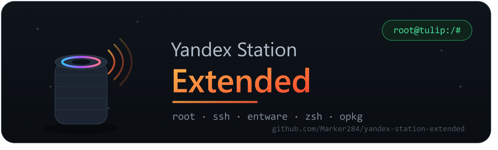

# # 🛰️ Yandex Station Extended ## Рут и моды для умной колонки Яндекса -# гайды • Discord server

🛰️ **Yandex Station Extended** — комьюнити по руту Яндекс.Станции.
Рут, SSH, Entware, свой софт и отключение лишней телеметрии. Гайды + помощь новичкам.
👉 https://https://discord.gg/yandexext

# 🛰️ Yandex Station Extended
### Рут, SSH и моды для умной колонки Яндекса

Хочешь больше контроля над своей Станцией? У нас ты научишься:
🔓 открывать рут на Яндекс.Станции
🐚 ставить SSH, Entware, zsh и свои пакеты
🚫 отключать телеметрию и ненужные обновления
🛠️ запускать собственный софт прямо на колонке

Что внутри:
📚 пошаговые гайды под разные модели
💿 проверенные инструменты и прошивки
💬 живая помощь — не бросим наедине с «кирпичом»
🐞 разбор багов и обмен опытом

👉 Залетай:https://discord.gg/yandexext