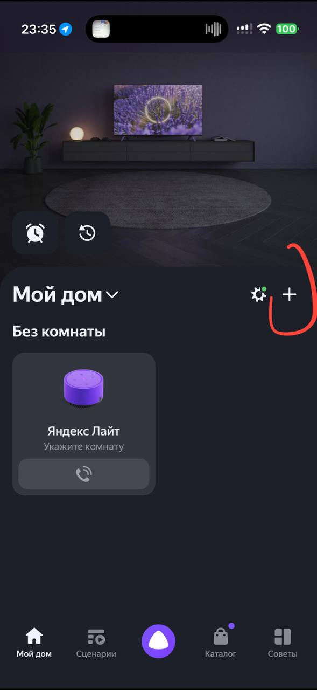
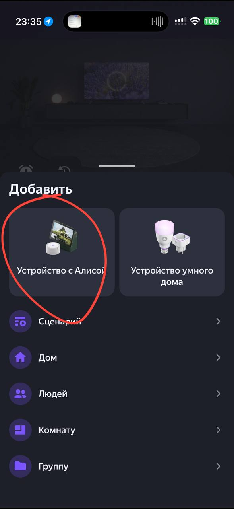
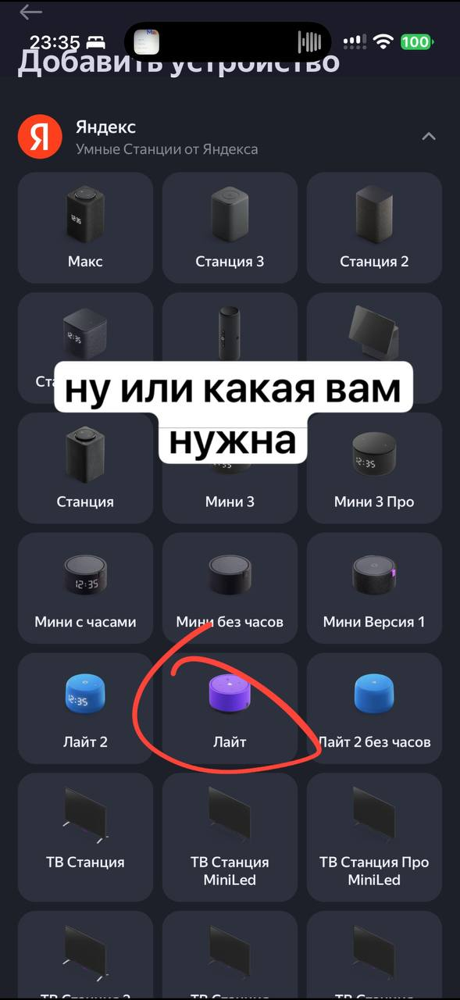
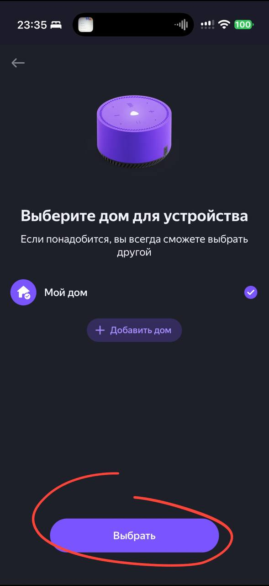
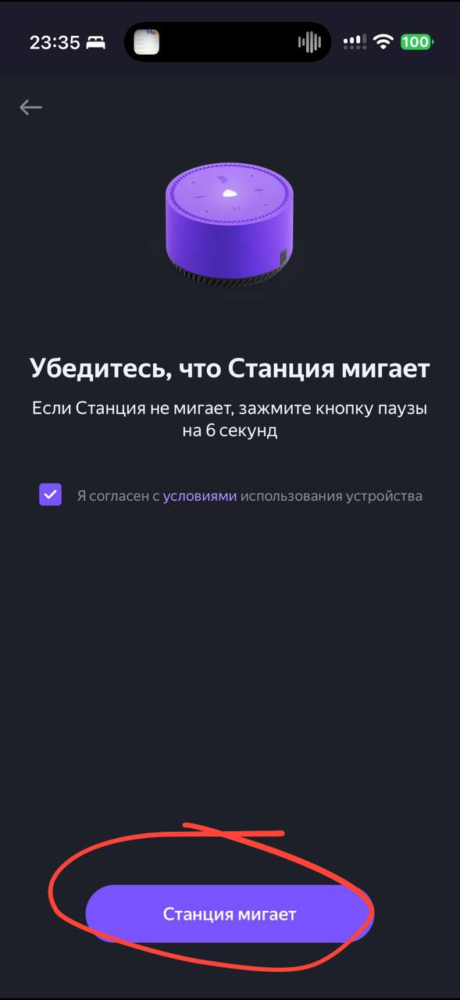
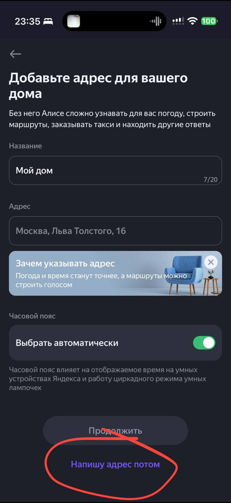
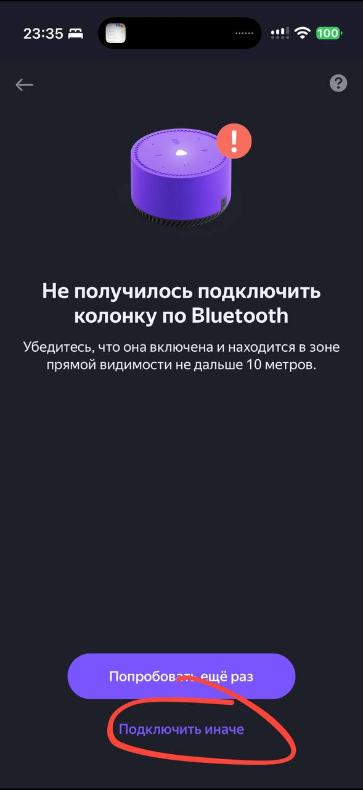
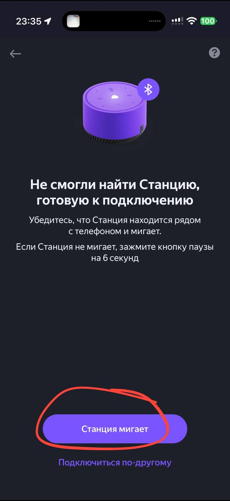
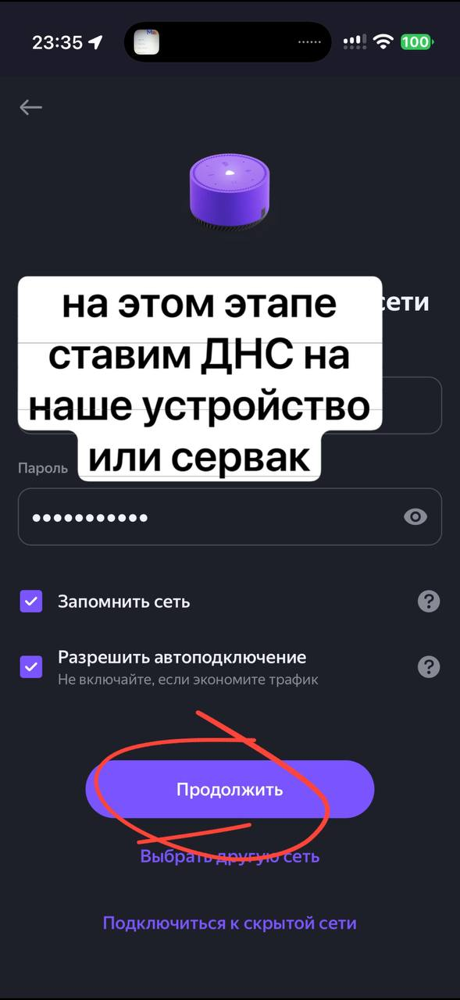
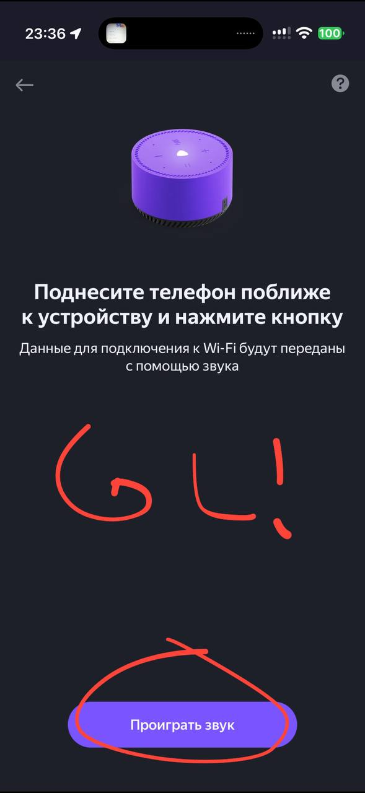

# Шаг 1. Root по сети: DNS-метод

Сетевой ADB с правами `root` без разборки корпуса, пайки и программатора. Займёт ~15 минут.

После этого шага переходите к [шагу 2](ssh.md): там SSH и отключение обновлений. Без него
Яндекс может прислать обновление и закрыть доступ.

!!! tip "Лайт 2 (Plum) — свой способ"
    Для Лайт 2 основной способ — [патч retail CA из factory](retail-ca.md): он работает и на
    сборках после 21 октября 2026 года, которые этот DNS-метод уже не открывает. Ниже Лайт 2
    упоминается только как запасной вариант для старых сборок.

**Способ с Android без компьютера:** [AliceBridge](root-android.md) — root телефона, хотспот, ADB и установка [пакетов YSE](packages.md) из одного приложения.

## Что понадобится

- роутер, в котором можно поменять DNS (Keenetic, OpenWrt, MikroTik, Asus…), **или** второй
  Android-смартфон, раздающий Wi-Fi;
- компьютер в той же сети с `adb` ([как установить](../internals/toolchain.md#adb-install));
- смартфон с приложением «Дом с Алисой» (или «Яндекс»);
- колонка и её блок питания.

!!! warning "Колонка будет сброшена к заводским настройкам"
    Её придётся заново привязать к аккаунту. Сброс очищает `/data` (ваши настройки и всё,
    что вы туда ставили).

## Инструкция { #dns-unlock }

Выберите способ — оба дают сетевой ADB с root:

=== "Вариант 1. Сервер 179.254.167.126"


    ### 1. Сбросьте колонку к заводским настройкам

    **Лайт (первого поколения)**

    1. Отключите кабель питания, подождите несколько секунд и вставьте его обратно.
    2. **Сразу после этого** зажмите кнопку паузы (▶‖) и держите 6–10 секунд, пока подсветка
       не станет жёлто-зелёной. Если зажать кнопку до подачи питания, сброса не будет.
    3. Отпустите кнопку: подсветка пульсирует голубым, колонка ждёт настройки.

    **Мини 2, Мини 3, Стрит**

    1. Отключите кабель питания.
    2. Зажмите кнопку отключения микрофона (или паузы).
    3. Не отпуская кнопку, вставьте кабель.
    4. Держите 10–15 секунд, пока подсветка не замигает и Алиса не скажет о начале сброса.

    **Лайт 2 (Plum), сборки до 21 октября 2026 года**
    1. Отключите кабель питания.
    2. Зажмите кнопку отключения микрофона и, не отпуская её, подключите питание.
    3. Держите кнопку 10–15 секунд, пока подсветка не замигает и Алиса не скажет о начале сброса.

    **Миди, Станция 2**
    1. Отключите питание.
    2. Зажмите центральную сенсорную кнопку (или кнопку микрофона сзади) и подключите питание.
    3. Дождитесь звукового сигнала и сообщения о начале сброса.

    Через 1–2 минуты колонка предложит настроить её через приложение.

    ### 2. Начните привязку в приложении — и остановитесь на Wi-Fi

    1. Включите на смартфоне Bluetooth и геолокацию.
    2. «Дом с Алисой» → **«+»** → **«Устройство с Алисой»**.
    3. Дойдите до экрана **«Выберите сеть Wi-Fi и введите пароль»**.

    !!! danger "На экране Wi-Fi ничего не нажимайте"
    «Подключиться» — только после шага 3. Если включить DNS раньше, приложение не сможет
    связать колонку с аккаунтом и выдаст ошибку.

    ### 3. Включите DNS `179.254.167.126` на роутере

    Колонка должна получить DNS `179.254.167.126`. Выберите свой роутер:

    === "Keenetic"

        **Веб-интерфейс:** «Сетевые правила» → «Домашняя сеть» → «Параметры IP и DHCP» →
        **DNS 1** = `179.254.167.126`, поле **DNS 2** очистите → «Сохранить».

        **Или CLI** — подменяет только нужный домен, остальная сеть не затронута:

        ```text
        ip host quasar.yandex.net 179.254.167.126
        system configuration save
        ```

        Откат после шага 2 — верните прежние DNS в веб-интерфейсе или выполните
        `no ip host quasar.yandex.net` и `system configuration save`.

    === "TP-Link"

        **Веб-интерфейс:** «Дополнительные настройки» → «Сеть» → «DHCP-сервер» →
        **Предпочитаемый DNS-сервер** = `179.254.167.126`, поле **Альтернативный DNS-сервер**
        очистите → «Сохранить». В старом (зелёном) интерфейсе те же поля обычно лежат в
        разделе «DHCP» → «Настройки DHCP».

        Откат после шага 2 — верните прежние значения (обычно поля оставляют пустыми).

    === "OpenWrt"

        Команды выполняются по SSH на роутере. Выберите **один** способ:

        === "Только домены активации (рекомендуется)"

            Пересылка в dnsmasq только для трёх доменов. Остальные запросы обслуживаются
            как обычно, в том числе через Podkop:

            ```sh
            uci add_list dhcp.@dnsmasq[0].server='/quasar.yandex.net/179.254.167.126'
            uci add_list dhcp.@dnsmasq[0].server='/quasar.yandex.ru/179.254.167.126'
            uci add_list dhcp.@dnsmasq[0].server='/scbh.yandex.net/179.254.167.126'
            uci commit dhcp && /etc/init.d/dnsmasq reload
            ```

            Правила действуют для этих доменов и их поддоменов у всех клиентов dnsmasq,
            а не только у колонки. Запросы клиентов напрямую к другим DNS-серверам этот
            способ не перехватывает.

            Проверено на OpenWrt 24.10.5 с Podkop: Мини 2, прошивка
            `0.369.1.46.4793643989.20261020.299`, и Миди, прошивка
            `0.369.1.46.4778262955.20261013.160`.

            <a id="rollback-openwrt-domains"></a>

            **Откат после шага 2** — удалите только добавленные записи:

            ```sh
            uci -q del_list dhcp.@dnsmasq[0].server='/quasar.yandex.net/179.254.167.126'
            uci -q del_list dhcp.@dnsmasq[0].server='/quasar.yandex.ru/179.254.167.126'
            uci -q del_list dhcp.@dnsmasq[0].server='/scbh.yandex.net/179.254.167.126'
            uci commit dhcp && /etc/init.d/dnsmasq reload
            ```

        === "Все DNS-запросы (DNAT)"

            !!! warning "Затрагивает всю сеть"
                Правило заворачивает DNS-запросы всей LAN и может сломать Podkop и другие
                настройки DNS. В таких сетях используйте пересылку только доменов активации.
                Перед переходом на неё удалите правило `Quasar-Unlock` (откат ниже).

            ```sh
            uci add firewall redirect
            uci set firewall.@redirect[-1].name='Quasar-Unlock'
            uci set firewall.@redirect[-1].src='lan'
            uci set firewall.@redirect[-1].proto='tcp udp'
            uci set firewall.@redirect[-1].src_dport='53'
            uci set firewall.@redirect[-1].dest_ip='179.254.167.126'
            uci set firewall.@redirect[-1].dest_port='53'
            uci set firewall.@redirect[-1].target='DNAT'
            uci commit firewall && /etc/init.d/firewall reload
            ```

            <a id="rollback-openwrt-dnat"></a>

            **Откат после шага 2** — удалите все правила `Quasar-Unlock`, даже если правило
            добавляли несколько раз. Цикл проверен через `sh -n`, на роутере отдельно
            не выполнялся:

            ```sh
            while :; do
                section="$(
                    uci show firewall |
                        sed -n "s/^\(firewall\.[^.]*\)\.name='Quasar-Unlock'$/\1/p" |
                        head -n 1
                )"
                [ -n "$section" ] || break
                uci delete "$section" || break
            done
            uci commit firewall && /etc/init.d/firewall reload
            ```

    === "Другой роутер"

        В настройках локальной сети найдите DNS-серверы, которые роутер раздаёт по DHCP:
        **DNS 1** = `179.254.167.126`, **DNS 2** — пусто. Обычно это раздел
        «Локальная сеть» / «LAN» → «DHCP-сервер» (Asus и другие).

        Если DNS там задаётся только для подключения к провайдеру (WAN), это не подойдёт:
        используйте раздачу с Android.

        Откат после шага 2 — верните прежние значения (обычно поле оставляют пустым или
        ставят IP роутера).

    === "Раздача с Android"

        Если роутер не даёт менять DNS:

        1. Раздайте Wi-Fi с одного телефона.
        2. На раздающем телефоне поставьте **DNS Changer** и задайте `179.254.167.126`.
        3. Привязывайте колонку с **другого** телефона к этой точке доступа.

    ### 4. Подключите колонку к Wi-Fi

    Вернитесь в приложение и нажмите **«Подключиться»**. Колонка подключится к сети,
    сходит на сервер разблокировки, помигает и издаст звук готовности.

    ### 5. Зайдите по ADB

    IP колонки посмотрите в списке клиентов роутера.

    ```sh
    adb connect 192.168.1.120:5555
    adb devices          # должно быть: 192.168.1.120:5555    device
    adb shell            # приглашение «#» — это root
    ```

    ### 6. Сразу переходите к шагу 2

    👉 **[SSH и отключение обновлений](ssh.md)** — сделайте это до того, как вернёте DNS.

    ### 7. Верните обычный DNS { #restore-dns }

    После шага 2 уберите `179.254.167.126` из настроек роутера — команды отката есть на
    вкладке вашего роутера в шаге 3. Доступ сохранится.

    - OpenWrt: [только домены активации](#rollback-openwrt-domains) или
      [DNAT](#rollback-openwrt-dnat).

=== "Вариант 2. Свой стенд на ПК"

    <a id="local-stand"></a>


    Альтернатива серверу `179.254.167.126`: DNS и HTTPS поднимаются на вашем компьютере
    (Windows, Linux или macOS), и колонка получает **настоящий ответ Яндекса**, в который
    добавлено `adbd.remoteActivation`. Никаких внешних сервисов — только свой ПК и роутер
    со сменным DNS.

    !!! info "Чем отличается от варианта 1"
        Первый вариант ходит на чужой сервер разблокировки. Второй — полностью локальный:
        вы видите запросы колонки, можете обновлять прошивку и включать ADB повторно после
        сброса. Подходит для тех, кто не хочет зависеть от чужого сервера.

    ### 1. Подготовьте ПК

    **Windows 10/11**
    1. Установите [Python 3.8+](https://www.python.org/downloads/) с галочкой
       **Add python.exe to PATH**.
    2. Склонируйте стенд — [github.com/krevetkqqq/lite-kit](https://github.com/krevetkqqq/lite-kit):

       ```powershell
       git clone https://github.com/krevetkqqq/lite-kit C:\lite-kit
       ```

       Без git — скачайте ZIP и распакуйте в `C:\lite-kit`:
       `https://github.com/krevetkqqq/lite-kit/archive/refs/heads/main.zip`
    3. Порты **53 (UDP/TCP), 80, 443** должны быть свободны (порт 53 иногда занимает
       служба «Общий доступ к подключению к Интернету»).

    !!! note "Репозиторий стенда"
        [github.com/krevetkqqq/lite-kit](https://github.com/krevetkqqq/lite-kit) — код,
        скрипты для Windows/Linux/macOS и установщик прошивок.

    **Linux**
    ```sh
    sudo apt install dnsmasq python3 openssl dnsutils
    git clone https://github.com/krevetkqqq/lite-kit ~/lite-kit
    ```
    Убедитесь, что порт 53 свободен (`systemd-resolved`/`avahi` не мешают).

    **macOS**
    ```sh
    brew install dnsmasq
    git clone https://github.com/krevetkqqq/lite-kit ~/lite-kit
    ```

    ### 2. Выберите прошивку

    Стенд умеет раздавать колонке нужную сборку: если в `firmware/` лежит `.zip`,
    а версия колонки отличается — он сам предложит обновление.

    !!! tip "Этот шаг можно пропустить"
        Если на колонке уже стоит нужная версия (или файл прошивки уже лежит
        в `firmware/`), ничего выбирать не нужно — переходите к запуску стенда.

    !!! warning "Какую сборку брать"
        | Модель | Версия |
        |---|---|
        | Лайт 1 (`yandexmicro`) | `0.369.1.46.4778262442.20261013.297` (сборка от 13.10.2026) |
        | Мини 1 (`yandexmini`) | сборка 2025 года: `1.305.4.16.3237824040.20250721` |
        | Мини 2, Мини 3, Лайт 2, Миди, Станция 2 и остальные | желательно **последняя сборка до обновления 20–21 октября 2026** |

        Более новые сборки сертификат не принимают — ADB через `get_sync_info`
        на них не поднимется.

    !!! tip "Лайт 1 на сборках после 21 октября 2026 года"
        Колонку с `0.369.1.50…` тоже можно открыть, но прошивка откатится на `.46`. Сброс
        грузит factory-образ из раздела `recovery` (`0.5.1.20.1624028365.20230208.factory-4`), а
        он стенду доверяет. После `POST /register` factory-образ не запрашивает `get_sync_info`,
        а ждёт обновления. Стенд отдаёт ему `.46` из `firmware/`, колонка скачивает 67 МБ,
        ставит прошивку и через несколько минут перезагружается. `.46` запрашивает
        `get_sync_info` и включает ADB с root.

        Поэтому стенд, который на `check_updates` отвечает только `{"hasUpdate":false}` (например,
        eQuasar из гайдов для Лайт 2 и Мини 3), здесь не годится: factory-образ так и останется
        ждать обновления.

        Проверено на Лайт 1 с `0.369.1.50…`: откат на `0.369.1.46.4778262442.20261013.297`, ADB с
        root, затем [шаг 2](ssh.md). Проверялся именно этот вариант — свой стенд. Отдаёт ли
        прошивку для отката сервер `179.254.167.126` из варианта 1, не проверялось.

    Скачать и положить в `firmware/<версия>.zip` можно установщиком:

    ```powershell
    .\install-firmware.ps1                 # меню: платформа -> версия (по цифрам)
    .\install-firmware.ps1 -List           # только список платформ
    .\install-firmware.ps1 -Platform yandexmicro -Version 0.369.1.46.4778262442.20261013.297
    ```
    ```sh
    ./install-firmware.sh                  # Linux / macOS
    ```

    Уже проверенные версии в меню помечены `<-- проверено (ADB работает)`.

    ### 3. Запустите стенд

    **Windows**
    ```powershell
    cd C:\lite-kit
    .\start.ps1        # сам запросит права администратора
    ```

    **Linux / macOS**
    ```sh
    cd ~/lite-kit
    sudo ./start.sh
    ```

    Скрипт напечатает **IP этого ПК** и проверит DNS. В логе (`log\server.log`,
    `log\yandex.log`, `log\local.log`, `log\dns.log`) видно каждый запрос колонки.

    ### 4. Включите DNS на роутере

    DNS 1 = **IP компьютера со стендом**, DNS 2 — пусто. Способы те же, что в
    [варианте 1](#dns-unlock) (вкладки шага 3), только вместо `179.254.167.126` — IP
    компьютера.

    Проверка с ПК:

    ```sh
    nslookup quasar.yandex.net <IP-роутера>   # должен вернуть IP компьютера
    ```

    ### 5. Привяжите колонку в приложении

    Действия те же, что в варианте 1: сброс → «Дом с Алисой» → «+» → «Устройство с Алисой»
    → дойти до выбора Wi-Fi. **DNS включайте только на экране выбора сети** — иначе
    приложение не сможет привязать колонку.

    !!! warning "Телефон — на мобильном интернете"
        Если телефон в той же Wi-Fi-сети, что и колонка, запросы приложения к
        `quasar.yandex.net` тоже уходят на стенд. Приложение не принимает его сертификат (в
        логе стенда каждые пару секунд `alert certificate unknown`), и настройка срывается —
        например, с ошибкой «Не получилось подключить колонку по Bluetooth». Выключите на
        телефоне Wi-Fi, оставьте мобильный интернет и Bluetooth, а сеть и пароль для колонки
        введите вручную. Тогда DNS можно включить и до сброса. Проверено на iPhone с Лайт 1.

    ??? example "Скриншоты: весь путь до экрана Wi-Fi (10 шагов)"
        <div class="shots">
          
          
          
          
          
          
          
          
          
          
        </div>

        <style>
        .shots {
          display: flex;
          gap: .6rem;
          overflow-x: auto;
          scroll-snap-type: x mandatory;
          padding-bottom: .4rem;
        }
        .shots img {
          flex: 0 0 auto;
          width: min(78vw, 320px);
          border-radius: 12px;
          scroll-snap-align: center;
          box-shadow: 0 6px 22px rgba(0,0,0,.35);
        }
        .shots img:target { outline: 2px solid var(--md-accent-fg-color); }
        </style>

    Листайте вправо — это десять последовательных экранов приложения, девятый и есть
    момент, когда нужно включить DNS.

    После «Подключиться» колонка сходит на ваш ПК, получит конфиг с `adbd` и откроет порт.

    ### 6. Проверьте ADB

    ```sh
    adb connect <IP-колонки>:5555
    adb shell id          # uid=0(root)
    ```

    Если порт закрыт:

    ```powershell
    .\check.ps1           # Windows
    ```
    ```sh
    ./check.sh            # Linux / macOS
    ```

    В логе стенда должно быть:

    ```text
    >>> [SYNC-REAL→] payload …, adbd: config.system_config.adbd=on, …, top.adbd=on
    ```

    ### 7. Сразу закройте доступ

    Пока не вернули DNS — переходите к [шагу 2](ssh.md): SSH и отключение обновлений.
    Стенд сам прошивку не навязывает: он отдаёт только ответ Яндекса (плюс `adbd`),
    а обновления закрываются на [шаге 2](ssh.md).

    ### Совместимость варианта 2

    Отдельно от таблицы выше — что реально проверено именно на локальном стенде:

    | Модель | Статус |
    |---|---|
    | Лайт 1 (`yandexmicro`, YNDX-00025) | ✅ проверено, в том числе с `0.369.1.50…` (откат на `.46`) |
    | Мини (`yandexmini`, `1.305.4.16.3237824040.20250721`) | ✅ проверено |
    | Мини 2 | ✅ проверено (рутована, версия прошивки не зафиксирована) |
    | Миди (`cucumber`, с часами) | ✅ проверено |
    | Лайт 2, Станция 2, Макс, Дуо Макс, Умный хаб | ❔ не проверялось |

    На проверенных моделях после привязки: `/get_sync_info` отдаёт `adbd.remoteActivation=true`,
    `adb connect <IP>:5555` проходит, `adb shell id` → `uid=0(root)`.


## Совместимость

| Модель | Статус |
|---|---|
| Мини 1, Мини 2, Миди, Станция 2, Стрит, Умный хаб | ✅ проверено |
| Лайт (1-го поколения) | ✅ проверено; сборки после 21.10.2026 — [свой стенд](#local-stand) с откатом на `.46` |
| Мини 3 (bergamot) | ✅ до 21.10.2026; на новых сборках — [retail CA и маркеры из factory](retail-ca-mini3.md) |
| Лайт 2 (Plum) | ➡️ основной способ — [retail CA из factory](retail-ca.md); DNS-метод — только сборки до 21.10.2026 |
| Станция Макс, Станция 1-го поколения | ❌ Android-платформа, способ не работает; для Станции 1 есть [AliceBridge](root-android.md#station-1) |

!!! note "Мини 2"
    Мини 2 получена рутом по этой инструкции; версия прошивки не зафиксирована
    (на момент проверки — актуальная стоковая), дальше ADB и SSH работали штатно.

---

## Как это работает

1. Сброс возвращает колонку в заводское состояние: `/data` очищен.
2. При первом подключении колонка запрашивает настройки у `quasar.yandex.net`. С DNS
   `179.254.167.126` запрос уходит на сервер разблокировки.
3. Сервер отвечает настройками, в которых сетевой ADB включён.
4. Прошивка создаёт маркеры `/data/quasar/activate_adb_quasmodrom` и
   `/data/quasar/activate_network_adb` и запускает `adbd` на порту **5555**.
5. При каждой загрузке `onboot.sh` вызывает `activate_adb.sh check`: пока маркеры на месте,
   ADB поднимается сам — DNS больше не нужен. На Мини 3 это не так: после возврата DNS ADB
   выключается, см. [раздел про возврат DNS](retail-ca-mini3.md#adb-after-dns).

---

## Если не получилось

??? failure "Приложение пишет «Не удалось подключиться к Wi-Fi»"
    DNS включили слишком рано. Уберите DNS, сбросьте колонку и пройдите привязку заново —
    DNS включайте только на экране ввода пароля Wi-Fi.

??? failure "Колонка в сети, но порт 5555 закрыт (`Connection refused`)"
    - На роутере включена DNS-фильтрация (Яндекс.DNS, AdGuard и т.п.) — отключите её.
    - Колонка могла запомнить старый адрес — передёрните питание.
    - Проверьте с ПК в той же сети: `nslookup quasar.yandex.net` должен вернуть `179.254.167.126`.

??? failure "`adb connect` пишет `unable to connect`"
    Компьютер и колонка должны быть в одной сети, не в гостевой (с изоляцией клиентов).
    Проверьте `ping <IP_колонки>`.
